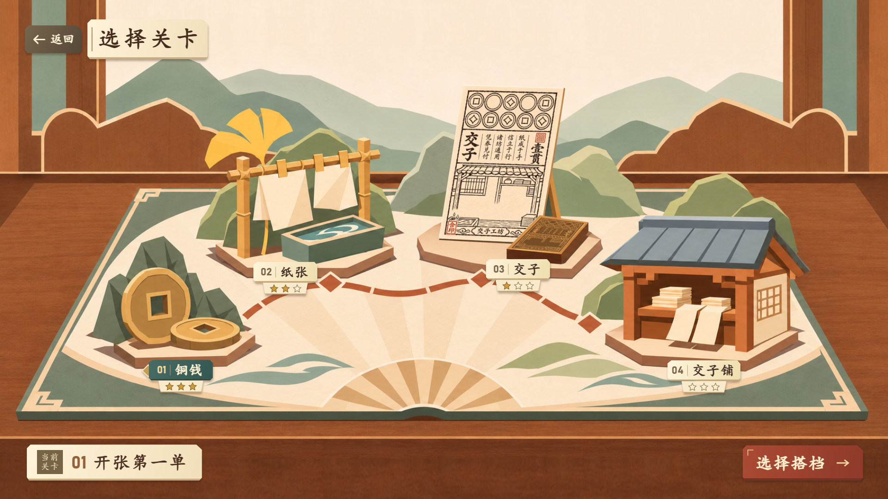

# 益州纸盘 · 选择关卡

[可打开的 HTML 预览](关卡地图排版_v04.html) · [无界面底图](分层/益州纸盘_首页配色底图_v04.png) · [制作记录](地图制作记录_v04.json)

桌面和册页共用俯视透视，铜钱、晾架、交子票和交子铺靠折脚立在纸面上。米白、暖木和灰青取自在用主页，朱红用于印章与主按钮。票后用灰青纸山衬托轮廓，票面套用项目原交子底票，前方木版按同一纹样作镜像单色转印示意。

| 任务 | 画面和玩家操作 | 后续程序接入与验收 |
| --- | --- | --- |
| F01 首关导航 | 当前 01「开张第一单」。左上返回主页，右下选择搭档。 | HTML 可用 Tab 和 Enter 导航，Esc 返回。两按钮打开仓库中的对应画面。Unity 接入时跳转到主页、双人选角状态。 |
| F13 历史星级 | 四节点依次显示 3、2、1、0 星，均为美术评审样例。 | 程序读取各关历史最高星级。当前焦点与开放条件分别判断。 |
| F17 关卡图 | 顺序为铜钱、纸张、交子、交子铺；每个节点各有一张编号签。 | 当前实施范围为首关。后续节点的名称、玩法和解锁条件须按后续关卡设计接入。 |

沿用[多关地图历史交接](../../Docs/UI多关地图与长卷选角交接_v01_20261121.md)与[四动物几何剪纸规范](../../Docs/UI统一设计规范_v03_20261122.md)。[桌面构图参考](参考/用户参考_桌面选关构图.png)、[用户圈出的红扇和票纹](参考/用户标注_票版与红扇.png)、[游戏原底票](../选角与多关卡UI_参考重构_v05_20261121/参考/用户原资源_交子底票.png)为最新稿的核对依据。

此前的平铺、写实桌面和彩色红扇方案存于「迭代」。当前 v04 为 1920×1080 静态评审整图，排版 HTML 支持本地导航预览；正式游戏状态和存档由外部 Unity 工程绑定。
