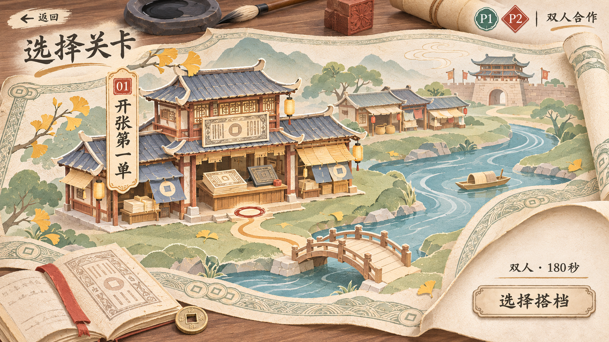

# 首关纸地图选择页

当前评审图：[01 首关纸地图 · 关卡选择 v01](01_首关纸地图_关卡选择_UI整页_v01_20261120.png)。实测 1672×941、8-bit、不透明 RGB PNG。

参考用户提供的桌面立体纸地图形式，重新设计交子铺、宋风街坊木构、商贸幌子、河桥和纸币长卷。没有沿用旧地图或旧纸坊布局，也不是实机关卡的缩略图。配色与当前选角 UI 相接，保留浅纸底、青绿山水、蓝灰屋顶和少量朱红／赭色；文字精简。

本轮仅有“01 开张第一单”一个正式关卡入口。远处小铺、城门和船为环境装饰，不代表新增关卡或已解锁内容。按钮“选择搭档”进入双人选角；P1 圆标、P2 菱标只说明双人模式，地图没有预先指定角色。名称沿用既有首关文档；正式回合 180 秒保持。

- [F01／F02／F17 交接](../../Docs/首关纸地图选择UI交接_v01_20261120.md)：玩家行为、程序产出、资产数量、接口、验收情景与路径版本。
- [生成提示词与来源](生成提示词与来源_v01_20261120.json)：内置 image_gen，最终生成只使用用户地图形式参考和当前选角 UI 风格参考。
- [文件尺寸与 SHA-256 核对](文件核对_v01_20261120.json)：项目副本与生成原图一致。
- [用户参考副本](参考/用户参考_桌面立体纸地图.png) · [当前四动物选角入口](../四动物双人选角UI_折屏印章_v03_20261120/从这里开始.md)。

交付计 **1 张完整页面**，另存用户参考 1 张；图内建筑、印章、按钮尚未拆件。没有实际模型、可操作页面或 Unity 测试结果。纸币纹样为画面装饰，不是历史复原或正式六组合票面；建筑位置不定义游戏行走、碰撞或工作台布局。
