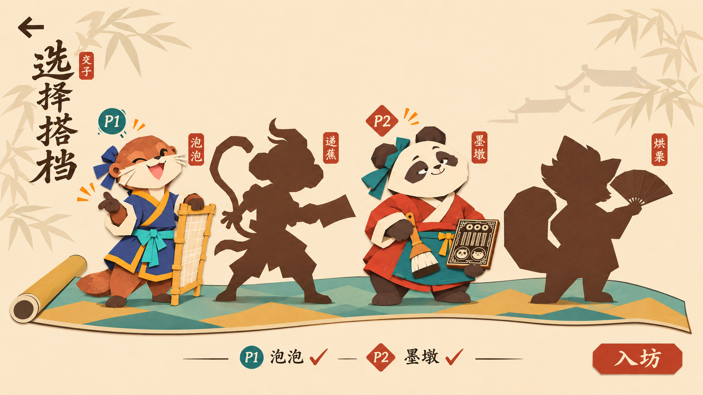
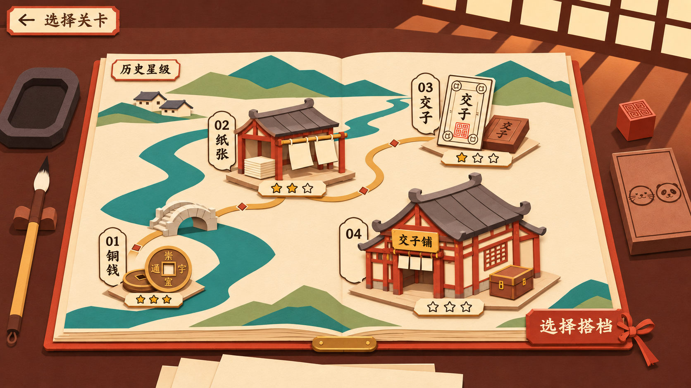
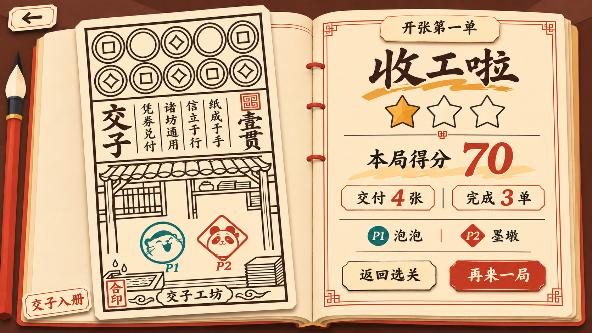
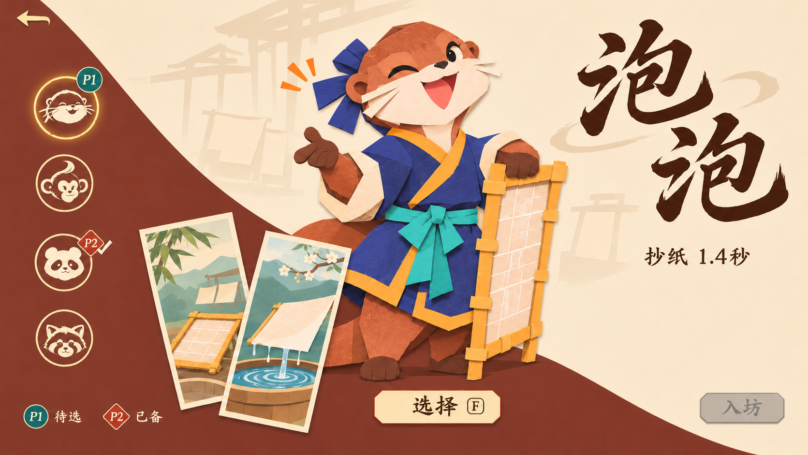
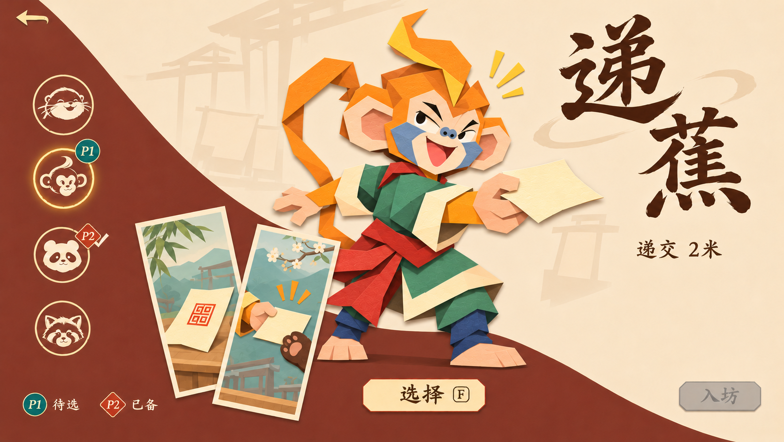
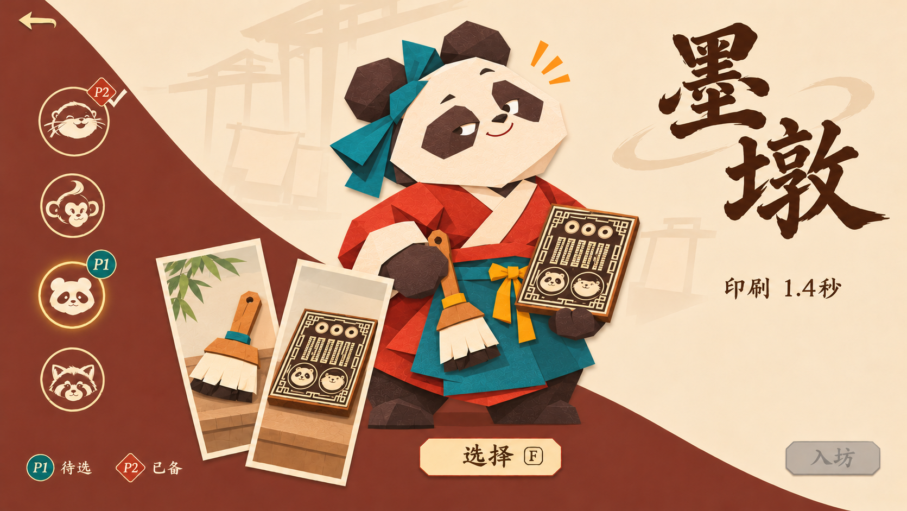
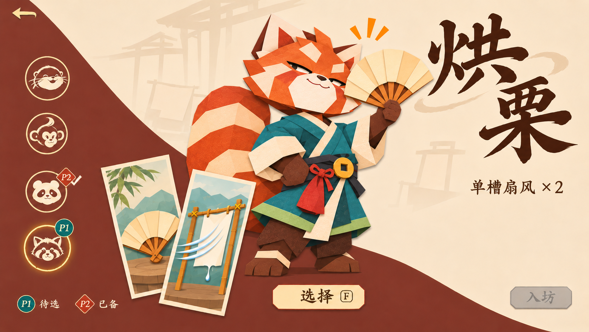

# 几何剪纸角色与核心UI制作入口

版本v01／2026-11-21；最后更新2026-11-22。用户已恢复制作，并明确沿用先前构图、只变换风格。本轮4张原横向人物设定、3张核心UI与4张单角详情整页已生成归档，全部待用户美术确认。采用几何剪纸色面、折层与统一视觉语言，未将新参考的竖卡布局照搬到原页面。

**当前11张PNG是静态评审图，另存1张未采用历史稿；不是模型、绑定、动画、可编辑分层、独立UI切片或Unity运行界面。** 原图与生成缓存保留。

**4张单角详情均已归档，待用户确认。** 四位各1张，沿用泡泡详情探索v05的横向构图：左侧4枚头章、中央大角色与2张倾斜工具卡、右侧大名字及1行技能、下方“选择”、右下禁用“入坊”。底部及相连左侧改为统一红棕色；用户指出初稿折边奇怪，当前泡泡v02改为一条舒展连续斜向曲线，删除台阶折边；另外3张采用该修正模板。P1青圆、P2朱菱、旧技能与示例玩家逻辑不变。当前共4张设定＋7张UI，即11张PNG；另存未采用历史稿1张，单独计数。

## 角色设定（4张）

| 图片 | 真实规格 | 版本与状态 |
| --- | --- | --- |
| [泡泡 · 水獭](角色设定/01_泡泡_几何剪纸设定_v01_20261121.png) | 1672×941，RGB PNG | v01；源/副本SHA一致，待确认 |
| [递蕉 · 金丝猴](角色设定/02_递蕉_几何剪纸设定_v01_20261121.png) | 1671×941，RGB PNG | v01；源/副本SHA一致，待确认 |
| [墨墩 · 大熊猫](角色设定/03_墨墩_几何剪纸设定_v01_20261121.png) | 1672×941，RGB PNG | v01；源/副本SHA一致，待确认 |
| [烘栗 · 小熊猫](角色设定/04_烘栗_几何剪纸设定_v01_20261121.png) | 1671×941，RGB PNG | v01；源/副本SHA一致，待确认 |

## 核心界面（3张）

| 图片 | 真实规格 | 保留的内容 |
| --- | --- | --- |
| [四动物长卷选角](界面整页/05_双人长卷选角_几何剪纸_v01_20261121.png) | 1672×941，RGB PNG | 原长卷v05四动物位置与状态；P1泡泡/P2墨墩，另两位剪影；准备独立 |
| [印刷台册页选关](界面整页/06_印刷台册页选关_几何剪纸_v01_20261121.png) | 1672×941，RGB PNG | 原册页v08节点、河道与大小关系；铜钱→纸张→交子→交子铺及3/2/1/0历史星样例 |
| [原票头章账册结算](界面整页/07_双页账册结算_几何剪纸_v01_20261121.png) | 1670×941，RGB PNG | 原双页账册与竖票结构；两动物头章；70分、4张、3单、1星样例 |

结算是原竖式交子结构的风格重绘，不是像素级旧票粘贴。头章仍在完整页面内，没有独立切片；示例成绩不是实际存档，也不代表正式六组合票已完成。

## 单角详情（4张当前稿）

| 图片 | 真实规格 | 状态 |
| --- | --- | --- |
| [泡泡单独选角·红棕连续曲线v02](界面整页/08_泡泡单独选角_红棕剪纸_v02_20261122.png) | 1671×941，RGB PNG | 已归档、源/副本SHA一致，待用户确认 |
| [递蕉单独选角·红棕连续曲线v01](界面整页/09_递蕉单独选角_红棕剪纸_v01_20261122.png) | 1670×941，RGB PNG | 已归档、源/副本SHA一致，待用户确认 |
| [墨墩单独选角·红棕连续曲线v01](界面整页/10_墨墩单独选角_红棕剪纸_v01_20261122.png) | 1671×941，RGB PNG | 已归档、源/副本SHA一致，待用户确认 |
| [烘栗单独选角·红棕连续曲线v01](界面整页/11_烘栗单独选角_红棕剪纸_v01_20261122.png) | 1670×941，RGB PNG | 已归档、源/副本SHA一致，待用户确认 |

[泡泡红棕折边初稿·未采用](迭代/08_泡泡单独选角_红棕折边_未采用_v01_20261122.png)仅保留在“迭代”，不得当作当前模板。4张当前详情统一采用连续斜向曲线；未获得用户最终美术认可。

## 核心界面预览

### 四动物长卷选角

### 印刷台册页选关

### 原票头章账册结算

## 单角详情预览

### 泡泡单独选角 · v02

### 递蕉单独选角 · v01

### 墨墩单独选角 · v01

### 烘栗单独选角 · v01

## 依据与核验

- [角色原始生成提示词](角色生成原始提示词_v01_20261121.json)
- [界面原始生成提示词](界面生成原始提示词_v01_20261121.json)
- [单角详情原始提示词](单角详情原始提示词_v01_20261122.json)
- [红棕底色边缘修正提示词](单角底色边缘修正提示词_v02_20261122.txt)
- [当前稿与历史稿的真实规格、来源及SHA-256](文件核对_v01_20261121.json)
- [制作交接、构图锁定与F编号](../../Docs/几何剪纸角色与核心UI交接_v01_20261121.md)
- [几何剪纸统一规范v03](../../Docs/UI统一设计规范_v03_20261122.md)
- [四张理想风格参考](../风格参考_几何剪纸_v01_20261121/从这里开始.md)

角色仍为泡泡／递蕉／墨墩／烘栗，旧技能和四选二六组合保持。几何剪纸参考只改变画法、纸层与统一视觉语言，不引入原参考的人类、犬类／狸猫新角色、武器、稀有度或卡片系统。所有图均为RGB不透明PNG，不能把纸面背景当作已清理透明精灵。
