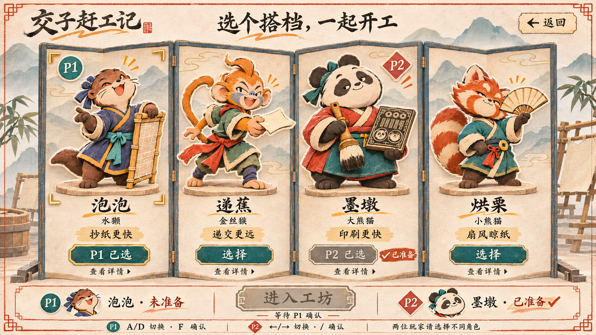

# 四动物双人选角 UI · 整页图片索引

本批为《交子赶工记》的选角视觉提案：总览 1 张、角色详情 4 张。角色采用手绘纸纤维、暖白贴纸切边、折纸般的体块和柔和投影；立体预览统一放在选择按钮上方，与宣纸屏风、纸层底座融合。只使用泡泡、递蕉、墨墩、烘栗四位动物，技能沿用现行旧版规则。

## 当前五页

| 图片 | 原始尺寸 | 内容与图例状态 |
| --- | --- | --- |
| [01 四角色总览](01_四角色总览_UI整页_v01_20261120.png) | 1672×941 | 四位横排；P1 泡泡已选、未准备；P2 墨墩已准备 |
| [02 泡泡详情 · 头像统一 v02](02_泡泡详情_UI整页_头像统一_v02_20261120.png) | 1672×941 | P1 查看泡泡；抄纸普通 2 秒→泡泡 1.4 秒；P2 墨墩已准备 |
| [03 递蕉详情 · 玩家角标统一 v02](03_递蕉详情_UI整页_玩家角标统一_v02_20261120.png) | 1671×941 | P1 查看递蕉；向空手搭档递交 1.2 米→2 米、工位不变且墙挡；P2 墨墩已准备 |
| [04 墨墩详情](04_墨墩详情_UI整页_v01_20261120.png) | 1672×941 | P1 查看墨墩；印刷普通 2 秒→墨墩 1.4 秒、盖印不变；P2 泡泡已准备 |
| [05 烘栗详情](05_烘栗详情_UI整页_v01_20261120.png) | 1672×941 | P1 查看烘栗；按住对高亮湿纸槽扇风，总干燥速率×2；P2 墨墩已准备 |

所有详情图的 P1 均未确认，进入工坊按钮处于等待 P1 的禁用示例。P1 为青绿圆标，P2 为朱红菱标，并结合编号、状态文字与准备勾标识别；不是只靠颜色。图中静态状态用于讲明层级，实际值由两人各自的浏览、选择和准备状态驱动。

五图都是不透明 RGB PNG。保留生成原始尺寸；递蕉比其他页少 1 像素宽，不做拉伸。后续拆件应按统一目标画布和布局锚点重排，不把整页图片作为运行时界面贴图。

## 设计与程序交接

- [F02 主任务及 F01／F13／F16 关联交接](../../Docs/四动物双人选角UI交接_v01_20261120.md)：玩家行为、程序产出、资产数量、接口、验收情景、文件与版本。
- [双人选角状态合同](双人选角状态合同_v01_20261120.json)：浏览与已选分离、双方不同角色、按确认选中并准备、取消与改选、详情返回及进入工坊条件。
- [角色造型原图](../四动物角色设定图_v01_20261120/从这里开始.md)：四张手绘角色设定；墨墩使用雕版修正 v02。
- [现行世界观与旧技能](../../Docs/设定同步_v01_20261120/世界观角色与技能统一设定_v01_20261120.md)：数值仍为设计初值，需要对方 Unity 工程联调。

图中的三维角色是本轮生成的立体纸艺效果示意，不是从已完成的四动物模型渲染。真实模型、材质、待机动作、独立头像、动态文字、按钮拆件、预览相机与 Unity 接入尚待制作；本轮没有运行验收结果。

## 来源、生成与版本

使用内置 `image_gen`，未使用 CLI。完整首轮与局部修正提示词、每张输入角色和输出映射见[生成提示词](生成提示词_v01_20261120.json)；文件尺寸、SHA-256、原始输出与项目副本一致性见[文件核对](文件核对_v01_20261120.json)。

参考副本保存于 [参考目录](参考/)：参考 01、02 仅取详情信息布局；参考 03 取四扇屏风的横向组织方式，不采用参考中的人类、文字或战斗技能。角色来自本项目四动物设定图。

泡泡 v02 统一墨墩与烘栗的小头像；递蕉 v02 补齐侧栏 P1 角标。两张未采用初稿留在[迭代目录](迭代/)，不作为当前接入图。当前交付计数为 **5 张整页**；3 张外部布局参考、2 张未采用初稿不计入这 5 张，也不把画中多个头像或按钮重复计为独立资产。
