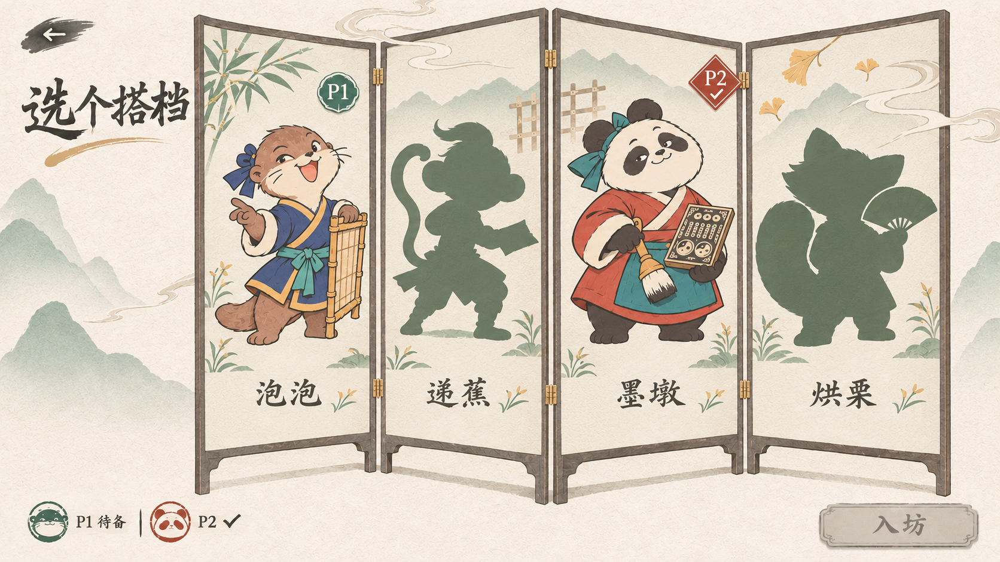

# 四动物选角 UI · 参考重排与剪影显现

当前评审稿为 **总览 v04＋四张详情 v03**。按用户参考重排画面并减少文字；最新总览进一步改为平涂人物、剪影／彩色选择状态，删除每栏选择按钮。均为静态图片，未制作实际四动物模型或可操作 UI。

| 当前图片 | 内容 | 尺寸 |
| --- | --- | --- |
| [01 四角色总览 · 剪影显现 v04](01_四角色总览_剪影显现_UI整页_v04_20261120.png) | 四位均在各自屏风画面内；泡泡／墨墩已选为彩色，递蕉／烘栗未选为剪影；无每栏选择按钮 | 1672×941 |
| [02 泡泡详情 v03](02_泡泡详情_留白_UI整页_v03_20261120.png) | 大角色、书法名、抄纸 1.4 秒 | 1672×941 |
| [03 递蕉详情 v03](03_递蕉详情_留白_UI整页_v03_20261120.png) | 大角色、书法名、递交 2 米 | 1672×941 |
| [04 墨墩详情 v03](04_墨墩详情_留白_UI整页_v03_20261120.png) | 大角色、书法名、印刷 1.4 秒 | 1672×941 |
| [05 烘栗详情 v03](05_烘栗详情_留白_UI整页_v03_20261120.png) | 大角色、书法名、单槽扇风×2 | 1672×941 |

总览采用浅米灰纸底、青绿山水、赭色小点缀与细纸纹。角色是绘在屏风内的平面手绘形象，屏风本体保留透视；不将人物画成凸出屏风的雕塑。底部水獭／熊猫章采用简化头部轮廓、少量阴刻与轻微印泥边缘。

四张详情保留斜切青绿底、大面积纸面留白、两张倾斜工具卡和模型效果预览下方的选择按钮。侧栏四角色图标统一为印章质感头部剪影；P1 圆标、P2 菱标及勾号表达玩家与准备状态。

总览示例为 P1 泡泡已选但未准备、P2 墨墩已准备。彩色由“已选”驱动，与“准备”分别显示；剪影表示未选，不表示未解锁。详情示例 P1 浏览未选；P2 为墨墩，墨墩详情中的 P2 则为泡泡。右下“入坊”均是禁用示例。

## 交接与来源

- [F02 与关联任务交接](../../Docs/四动物双人选角UI参考重排交接_v03_20261120.md)：玩家行为、程序产出、资产数量、接口、验收与路径版本。
- [既有双人状态合同](../四动物双人选角UI_v01_20261120/双人选角状态合同_v01_20261120.json)：仅沿用输入与状态规则；其中旧图片路径不是本轮视觉入口。总览仍可用 F／斜杠确认，去掉按钮不等于取消选择功能。
- [完整初稿、提亮与四详情提示词](生成提示词与来源_v03_20261120.json) · [最新总览修正提示词](总览修正提示词_v04_20261120.json)：全部使用内置 image_gen，保留原始输入和生成输出映射。
- [当前五图与历史稿尺寸、哈希核对](文件核对_v04_20261120.json)。五张当前图均为 8-bit、不透明 RGB PNG，与原始输出逐字节一致；没有 Unity 功能测试结果。
- [用户三张布局参考](../四动物双人选角UI_v01_20261120/参考/) · [角色设定图](../四动物角色设定图_v01_20261120/从这里开始.md)。参考中人类、技能雷达、四技能数量均未沿用。

历史保留：本目录的总览 v03 已被 v04 取代；[迭代目录](迭代/)存两张过暗的 v02 初稿；[旧厚框版五页](../四动物双人选角UI_v01_20261120/从这里开始.md)仅供对照。当前交付计 5 张整页；画中头像、章、按钮与纸卡尚未拆成独立组件。
