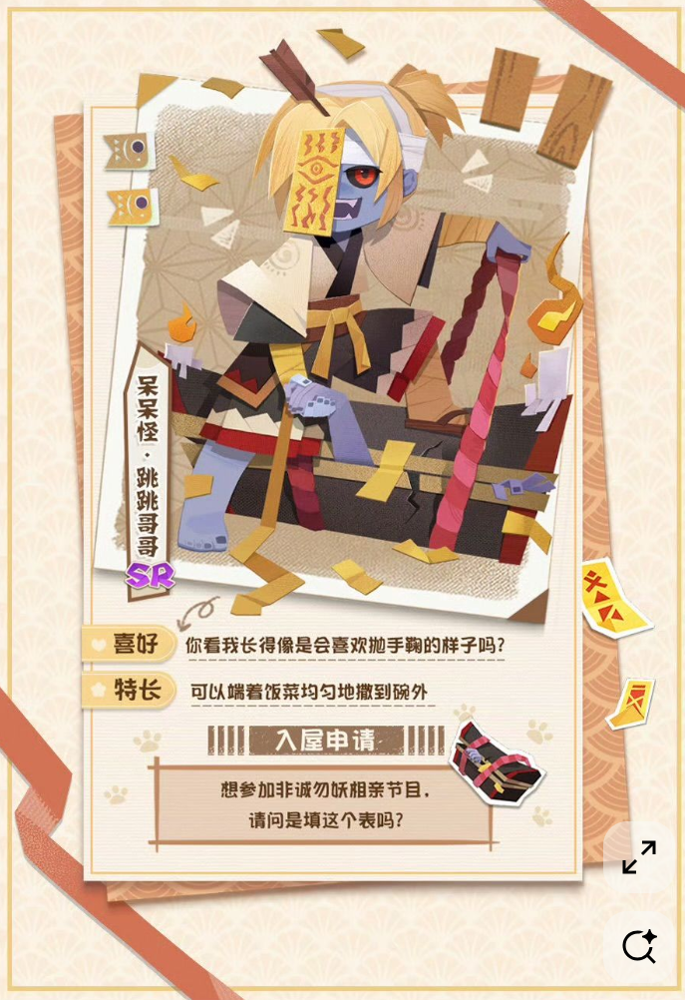
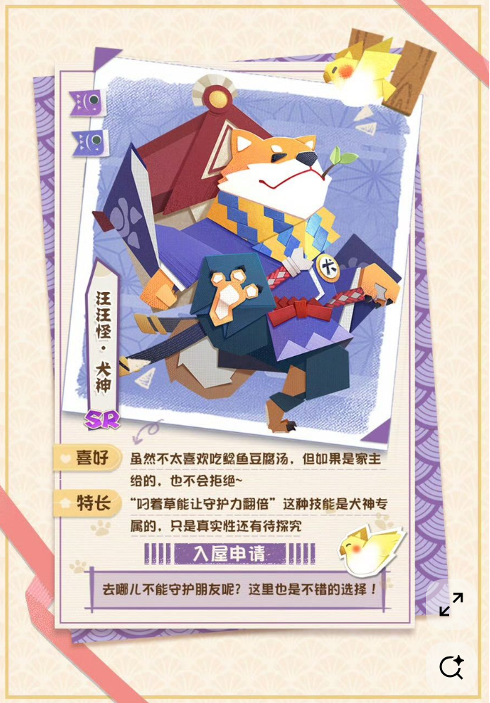
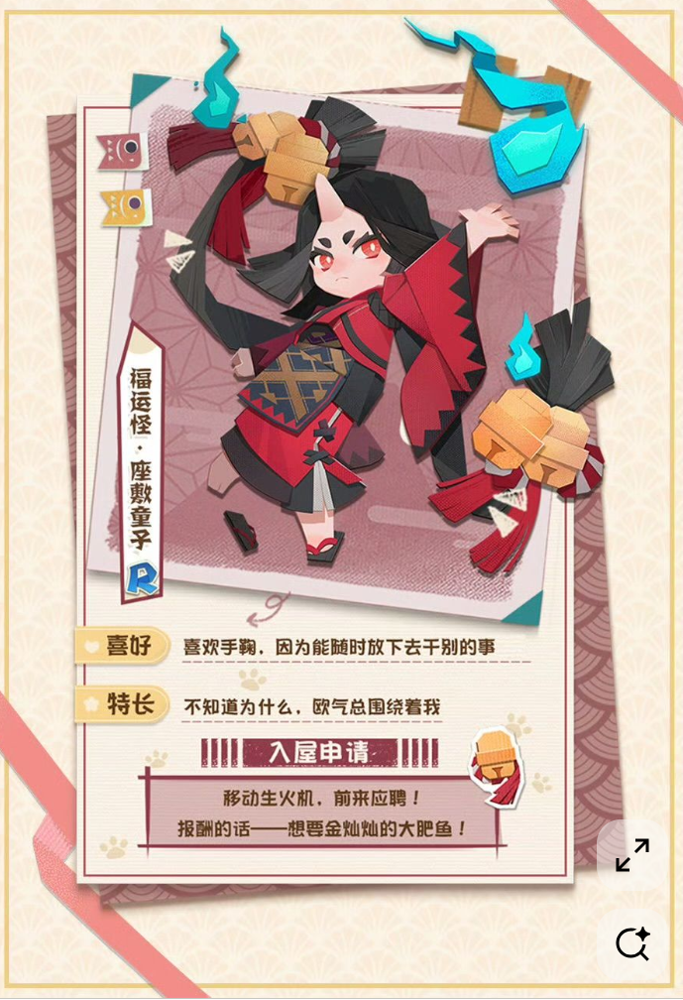
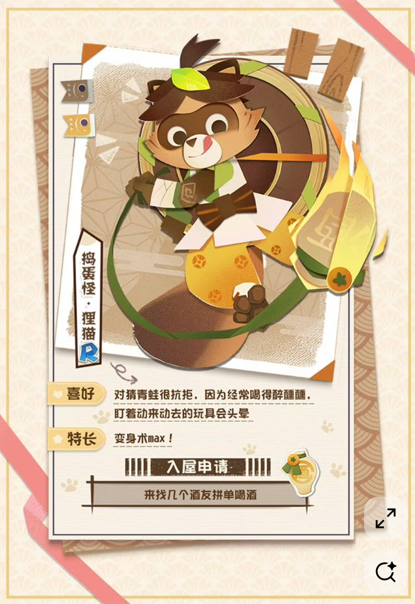

# 用户选定风格参考：几何剪纸与折纸拼贴

2026-11-21，v01。用户原话：“我找到了理想的参考风格，同步到我的项目文件和github上”。本目录四张截图为新的优先美术风格依据，优先于此前未获认可的UI/插图及规范v01。**用户确认的是参考风格，不是已经完成本项目角色重绘或游戏页面。** 本次只原样保存参考、更新规范和索引，不生成新图；原文件和已交ZIP保持原样。

[统一设计规范v02](../../Docs/UI统一设计规范_v02_20261121.md) · [来源、尺寸与SHA-256](来源与文件核对_v01_20261121.json) · [根目录索引](../../../README.md)

## 四张原图

| 参考 | 重点 |
| --- | --- |
| [01_几何剪纸人物_暖赭配色](01_几何剪纸人物_暖赭配色_参考.png) | 硬边折纸衣片、块面明暗、暖赭与深色对比、纸卡叠层；687×1002 PNG |
| [02_几何剪纸人物_朱红青色](02_几何剪纸人物_朱红青色_参考.png) | 朱红主体与青色点缀、动态剪影、宽窄色面组织；689×1008 PNG |
| [03_几何剪纸动物_蓝紫配色](03_几何剪纸动物_蓝紫配色_参考.png) | 动物脸部几何归纳、折线尾部和肢体、蓝紫与橘色分离；696×999 PNG |
| [04_几何剪纸动物_棕绿配色](04_几何剪纸动物_棕绿配色_参考.png) | 圆方对比的动物轮廓、纸层错位、棕绿暖色组合；693×1008 PNG |

## 采用的视觉语言

- 角色由有设计感的大几何色面拼成：耳、脸、衣摆、袖口、尾巴都先读轮廓；边缘有折线变化，圆弧用于必要的脸部识别。
- 用相邻明暗色面、纸层错位、折边和短柔影解释体积；避免塑料玩具光泽、写实毛绒、厚重浮雕和满幅笔刷描边。
- 纸张印纹、网纹和纹样可局部点到为止。大片主体保持清楚、平整，不能把纸质感理解成全屏脏颗粒。
- 共用暖米白的衬纸和统一纸签/卡角系统；各角色可以有自己的主色和辅色，以小面积鲜明点缀拉开层次。学习配色关系，不锁死上一版未确认的六个色值。
- 排版用主体插画、层叠底纸、少量标签和留白形成主次；装饰有组团和节奏，不给每一块空白添图案。

## 项目转译边界

角色仍是泡泡（水獭）、递蕉（金丝猴）、墨墩（大熊猫）、烘栗（小熊猫），名字、性别、旧技能和四选二六组合不变。参考里的角色身份、名字、妖怪设定、人类外形、武器、符咒、稀有度、喜好/特长文案和“入屋申请”不自动成为游戏内容；截图按钮也只是原图组成。

采用几何剪纸画法时，人物、场景、道具、插图和UI需要同一套色面、纸层与投影语言。场景仍是宋代灵感交子纸坊，建筑结构与透视须合理；不能直接把参考中的建筑或服饰当作已核定的宋代资产。

四张都是竖版角色介绍卡，只确定画法和版式层次，**不把本游戏改成竖屏、卡牌抽取或新养成系统**。已有双人归属/准备规则、三枚星级、原竖式交子配两动物头章等功能要求仍保留；实际界面重绘另按用户后续任务执行。

## 状态与验收

原图4份已逐文件与临时附件比对SHA-256，一致后归档；本目录保留原尺寸和原始像素。独立游戏角色、头章、UI组件、模型、绑定、动画新增数量均为0。具体F01/F02/F13/F17接口、资产数量与验收情景见规范v02的对齐表。

## 图片预览

| 暖赭与朱红青色 | 蓝紫与棕绿 |
| --- | --- |
|  |  |
|  |  |
