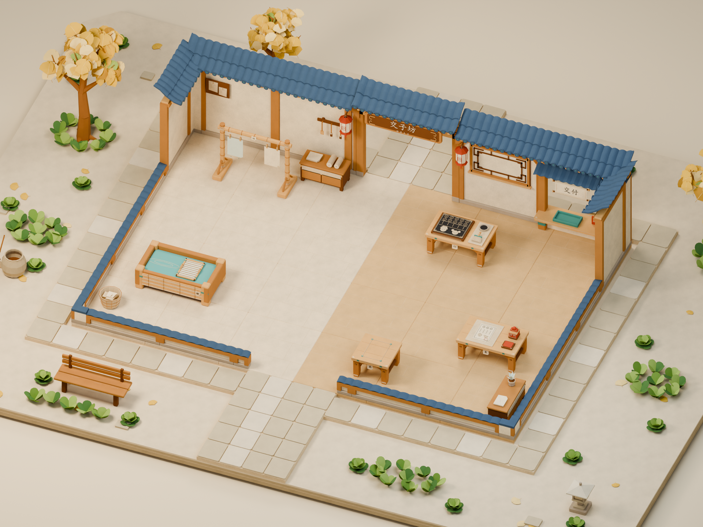

# 首关场景 v04：暖色纸坊与宣纸质感

版本：v04_20261111。主任务 F15，关联 F04—F09。按用户要求，以[当前敞口概念图](../../../03_历史成果/原工作区/output/jiaozi-gangongji-visual-kit-20261103-v2/02_游戏概念图_敞口修正版.png)为风格来源，改善建筑、工位结构与纸质材质，采用暖纸白、木色、靛青和朱红。风格是架空古代纸坊，不作为宋制建筑的考据复原。

**v04 源文件、GLB 与 7 张实际渲染已交付，49 项资产检查全部通过。** 本轮使用 Blender 5.3.0 后台生成、复开与 GLB 重新导入验证，未在 GUI 重载。仍为静态美术场景，Unity 交互、碰撞、导入朝向和双人试玩未验收。

## 1. 本轮交付入口

已交付 10 个主文件（模型 2、渲染 7、核验 JSON 1）及本说明。目录为 `01_游戏开发/Models/首关场景_v04_20261111/`，版本均为 v04_20261111。7 张预览均为 1920 × 1440。

| 文件 | 用途 | 当前状态 |
|---|---|---|
| [首关_开张第一单_v04_20261111.blend](首关_开张第一单_v04_20261111.blend) | 可编辑纸坊、工位、背景与打包材质 | 已后台复开 |
| [首关_开张第一单_v04_20261111.glb](首关_开张第一单_v04_20261111.glb) | 场景网格与材质导出 | 963/963 网格独立复导通过 |
| [预览_纸坊主效果_v04_20261111.png](预览_纸坊主效果_v04_20261111.png) | 新增纸坊美术主效果机位 | 已渲染与视觉检查 |
| [预览_外景总览_v04_20261111.png](预览_外景总览_v04_20261111.png) | 内外场完整美术展示 | 已渲染，尺寸核验通过 |
| [预览_游戏机位_v04_20261111.png](预览_游戏机位_v04_20261111.png) | 原游戏相机下工位识别与遮挡 | 已渲染，原游戏相机保持 |
| [预览_俯视_v04_20261111.png](预览_俯视_v04_20261111.png) | 布局、净通道、站位与铺装 | 已渲染，尺寸核验通过 |
| [预览_纸感细节_v04_20261111.png](预览_纸感细节_v04_20261111.png) | 宣纸短纤维、压痕及工位结构 | 已渲染与视觉检查 |
| [预览_银杏庭院_v04_20261111.png](预览_银杏庭院_v04_20261111.png) | 银杏与外围风格协调 | 已渲染，尺寸核验通过 |
| [预览_纸片草丛_v04_20261111.png](预览_纸片草丛_v04_20261111.png) | 圆叶纸片与去除拼色底盘后的表现 | 已渲染，尺寸核验通过 |
| [场景核验_v04_20261111.json](场景核验_v04_20261111.json) | 实测数量、尺寸、接口、材质与渲染记录 | 49 项全部通过，含文件 SHA-256 |

[本轮脚本目录](../../Scripts/Blender/首关场景_v04_20261111/)保留生成与核验方法。[v03 模型说明](../首关场景_v03_20261110/制作说明_首关场景_v03_20261110.md)及其产物不覆盖。

## 2. 美术改造范围

- **建筑**：已制作曲檐叠瓦、回纹花格、附墙“交子坊”匾额 1 块与宫灯 2 盏；楷体字已转网格，宫灯连接木构。屋顶保持敞口，主要台面清楚。门柱包边、墙框和柜顶共面重叠已修正，实际主效果与近景中的明显黑块已消除。
- **工位**：抄纸槽与晾架加强竹帘、绳扎；木台体现榫卯和层叠边；印刷、盖印与交付突出木刻、篆印、卷轴等结构。固定工具与可动件分开，工位外观不引入新加工步骤。
- **纸质**：旧材质的规则横竖织布纹、周期斜线和过强噪点，改为随机方向短纤维、低频纸浆斑纹、少量局部压痕与浅褶皱。远看保留干净大色块，近看可辨纤维；木纸、瓦纸、纸边分别控制强度。
- **可导出材质**：23 种纸艺材质使用 24 张打包 1024 纹理，Base Color 直连与切线 Normal Map 保留；统一 UV 尺度。GLB 复导得到 24 张图像和 23 个 Normal Map 节点。纸面与地面增强随机短纤维、柔和纸浆和局部浅褶皱，木纸更克制；近景可读且无规则织布纹。
- **植物**：保留圆润宽叶薄纸片、浅折痕和深浅绿叠色；去掉绿植棋盘拼色圆盘底。草形继续依据[用户参考](../../Art/场景关卡/首关纸片草丛参考_v01_20261110/用户参考_圆叶纸片草丛_v01_20261110.png)及[来源说明](../../Art/场景关卡/首关纸片草丛参考_v01_20261110/来源说明.md)。外围仍为非交互背景。
- **灯光与相机**：实际采用 Cycles CUDA GPU、40 samples、OpenImageDenoise 降噪；AgX、Medium High Contrast、曝光 +0.35。新增纸坊主效果相机仅用于美术展示，原游戏相机保持。

实际场景共 **1131 个对象、970 个网格对象**（含不导出的参照网格），GLB 导出 963 个网格。内场保留 5 组柜子、纸篓和墙饰。外围共 43 个非交互根：20 × 15 m 纸层地台，96 块地砖，3 棵银杏／420 片扇叶，22 簇独立圆叶纸片草／305 片叶，8 组纸草地／65 簇／325 片叶，30 片落叶、石灯 2、长凳 1、缸与扫帚组 1、小石 8。纸草合计 87 簇、630 片叶；外围不构成新增可玩区域。

## 3. 尺度与接口保持

内场仍为 12 × 8 m、24 地块、五工位加共享台，共 6 套工位；保留 7 个物料锚点、7 个操作目标与 7 个参考站位。双槽晾架独立，槽中心距 1 m；普通台面高 0.65 m；主通道仍为布局 z=3.3—5.7，净宽 2.4 m。角色碰撞初值为直径 0.65 m，真实角色尚未在本场景接入。

坐标与尺度来源见[尺寸 JSON](../../Art/场景关卡/首关三视图_v02_20261110/尺寸与布局_v02_20261110.json)；操作侧和锚点基线见[v01 说明](../首关场景_v01_20261110/制作说明_首关场景_v01_20261110.md)。Blender X/Y 为地面、Z 向上；Unity 轴向和前后符号仍须目标工程验证。

**工具附件高度与整体包围盒已随美术改造变化。** 印台最高点 0.774 m、盖印台 0.960 m、共享台含纸层最高点 0.660 m，基础台面仍为 0.650 m。本轮已核验实际占地、落地、台高、根位置与 21 个游戏锚点接口；XY 边界与 v03 保持在检查容差内。交付窗实际深度约 0.6066 m，在名义 0.6 m 的 0.01 m 容差内。未把全世界 AABB 完全相等当作要求。门饰保留实际 2.4 × 2.1 m 净口。

## 4. F 任务交付对应

下表的静态资产已生成并完成本轮资产检查；运行交互仍待外部 Unity 工程。主模型路径统一为本目录 `首关_开张第一单_v04_20261111.blend` 和同名 `.glb`，核验路径为 `场景核验_v04_20261111.json`。验收情景中的运行规则须由程序联调确认。

| 任务 | 玩家行为 | 美术资产及数量 | 程序产出／接口要求 | 验收情景 | 文件路径／版本 |
|---|---|---|---|---|---|
| F15 场景 | 两区移动、会车、识别主要工位 | 场景 1 套、24 地块；建筑外观一组，匾额 1、宫灯 2；效果预览 7 张，外围数量见上文 | 待接入新场景几何与材质；保留游戏相机、通道、出生参照及非交互景物分类；本轮不实现 Unity 逻辑 | 曲檐花格与附墙牌匾清楚；不挡主要台面、双槽和入口；纸质干净，无织布格纹；主效果相机与游戏相机分开 | 主模型、7 张 `预览_*_v04_20261111.png`、核验 JSON；v04_20261111 |
| F04 拿放交接 | 持一件、递交、暂存 | 共享台 1、单槽锚点 1 | 保留 `station_shared` 根与单槽；新榫卯外观不增加交互区，逻辑待接入 | 共享台为空且容易识别；台边不侵入递交与会车路线；满台拒收由程序验证 | 主模型 `station_shared`、核验 JSON；v04_20261111 |
| F05 抄纸 | 空手加工、取湿纸 | 抄纸槽 1；槽体、水面、独立帘框各 1，湿纸点 1 | 保留 +z 操作侧、帘框枢轴、纸张锚点；竹帘绳扎为外观 | 帘框与槽体结构可辨，不穿台；可接近操作点，湿纸状态可读；加工规则待接入 | 主模型 `station_pulp`、核验 JSON；v04_20261111 |
| F06 晾干 | 选择 A/B 挂纸并取干纸 | 晾架 1、独立挂位 2 | 保留 A/B 操作／物料／站位节点与 1 m 中心距；绳扎不成为额外操作 | 两张纸不被竹构和绳结遮挡；两槽可分别接近；计时与拒收由程序验收 | 主模型 `station_dry`、核验 JSON；v04_20261111 |
| F07 印刷 | 放干纸、加工为黑票 | 印台 1、木刻工具组 1、纸张点 1 | 保留 -z 操作侧与组合票接口；木刻浮雕和工具高度另测 | 木刻与黑墨可辨，附件不挡纸面或站位；不把几何票面当正式组合贴图 | 主模型 `station_print`、核验 JSON；v04_20261111 |
| F08 盖印 | 放黑票、盖朱印 | 盖印台 1、独立章 1、纸张点 1 | 保留 +z 操作侧、章枢轴及落章接触点；篆印外观不改变计分或状态机 | 章与票面能对位，朱印可辨；新章高度不被误计作台高；动画与重复盖章规则待验收 | 主模型 `station_stamp`、核验 JSON；v04_20261111 |
| F09 交付 | 向窗口交朱票 | 窗口 1、接收与回执点各 1；卷轴表现一组 | 保留室内 -z 操作侧和接收规则；附墙装饰与卷轴不新增槽位 | 窗口明显、正面可达；回执与卷轴不遮接收区；材料校验和原子计分待接入 | 主模型 `station_delivery`、核验 JSON；v04_20261111 |

## 5. 核验结果与联调边界

49 项自动检查全部通过：6 工位、24 地块、7 组接口、双槽 1 m 间距、基础台高、实际占地与落地、2.4 m 净通道、真实门饰净口、装饰与操作站位间距、非交互标记、外围与入口清空、原游戏相机、7 张 PNG 尺寸、GLB 网格／根点／锚点／贴图／法线复导等。外部图像依赖为空，字体数据为 0。

静态可达性采用 0.1 m 四邻域网格，角色半径 0.325 m 加 0.05 m 余量，7 个操作站位均可达；围墙简化，未模拟双人碰撞，不能替代 Unity 物理和双人试玩。视觉检查确认主效果与纸感近景中的明显共面黑块已消除，纸浆纤维可读、主工作台保持清楚；自动检查不代替美术确认。

源文件仅后台复开，未 GUI 重载；场景没有可玩角色或控制器，票面仍为几何示意。Unity 导入朝向、运行拿放、加工状态、碰撞和双人会车继续待验收。旧版[45 项 v03 记录](../首关场景_v03_20261110/场景核验_v03_20261110.json)独立保留。任务基线采用[F01—F20 对齐表](../../Docs/开发颗粒度对齐表_v02_20261110.md)，联调对接另一位开发者的工程、提交号和测试结果。
