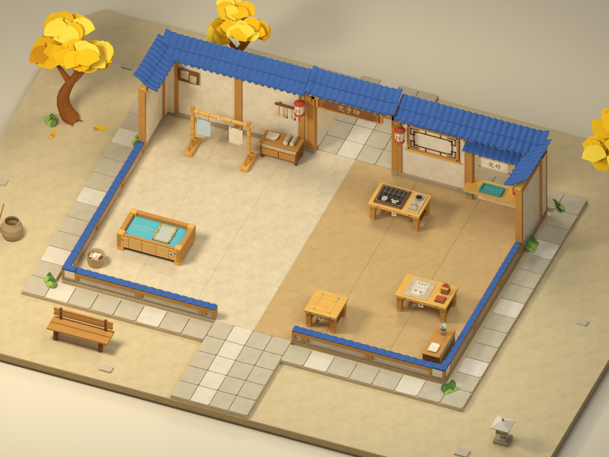

# 首关场景 v05：金黄银杏与贴墙纸草

版本：v05_20261111。主任务 F15，关联 F03—F09。依据用户确认的[银杏树与贴墙纸草参考](../../Art/场景关卡/首关植被色彩参考_v01_20261111/用户参考_银杏树与贴墙纸草_v01_20261111.png)及[来源说明](../../Art/场景关卡/首关植被色彩参考_v01_20261111/来源说明.md)，已重做银杏与贴墙纸草，恢复鲜明金黄、蓝瓦、暖木和绿色，保留 v04 的细腻纸质、敞口纸坊与工位结构。风格属于架空古代纸艺世界。

**v05 源文件、GLB 与 7 张实际渲染已交付，52 项资产检查全部通过。** 使用 Blender 5.3.0 后台生成、复开与 GLB 复导，未进行 GUI 重载；Unity 运行联调仍未验收。[v04 已交付说明](../首关场景_v04_20261111/制作说明_首关场景_v04_20261111.md)及模型完整保留。

## 1. 交付入口

已交付 10 个主文件（Blender、GLB、7 张 PNG、核验 JSON）及本说明，目录为 `01_游戏开发/Models/首关场景_v05_20261111/`。实际数量、渲染参数和检查结果记录于核验 JSON。

| 文件 | 用途／当前状态 |
|---|---|
| [首关_开张第一单_v05_20261111.blend](首关_开张第一单_v05_20261111.blend) | 可编辑模型与打包纸质材质；已后台复开 |
| [首关_开张第一单_v05_20261111.glb](首关_开张第一单_v05_20261111.glb) | 场景网格与材质导出；896/896 网格复导通过 |
| [预览_纸坊主效果_v05_20261111.png](预览_纸坊主效果_v05_20261111.png) | 金黄、蓝瓦、暖木与绿色的整体关系；已渲染与视觉检查 |
| [预览_外景总览_v05_20261111.png](预览_外景总览_v05_20261111.png) | 3 棵银杏与贴墙、树根草组分布；已渲染与视觉检查 |
| [预览_游戏机位_v05_20261111.png](预览_游戏机位_v05_20261111.png) | 原游戏相机下工位可读性；已渲染，相机保持检查通过 |
| [预览_俯视_v05_20261111.png](预览_俯视_v05_20261111.png) | 内场、净通道、入口与外围边界；已渲染，尺寸检查通过 |
| [预览_纸感细节_v05_20261111.png](预览_纸感细节_v05_20261111.png) | 颜色调整后纸浆、短纤维、浅折痕的表现；已渲染，尺寸检查通过 |
| [预览_银杏庭院_v05_20261111.png](预览_银杏庭院_v05_20261111.png) | 弯干、大扇叶错层成冠与树根连接；已渲染与视觉检查 |
| [预览_纸片草丛_v05_20261111.png](预览_纸片草丛_v05_20261111.png) | 左前墙角的低矮圆叶薄纸片；已渲染与视觉检查 |
| [场景核验_v05_20261111.json](场景核验_v05_20261111.json) | 52 项全部通过，含模型与 7 张 PNG 共 9 个文件的 SHA-256 |

7 张预览均为 1920 × 1440。实际使用 Cycles CUDA GPU、40 samples、OpenImageDenoise 降噪；色彩管理为 **Standard／None／曝光 0**。环境强度 0.28；主灯 1700 W／尺寸 4.5 m，补光 550 W／8 m，轮廓光 700 W／6 m。[本轮生成与核验脚本](../../Scripts/Blender/首关场景_v05_20261111/)保留具体配置。

场景含 **1043 个对象、903 个网格对象**；导出的 896 个网格全部复导成功。23 种纸艺材质使用 24 张打包 1024 纹理，GLB 复导保留 24 张图像与 23 个 Normal Map 节点，无外部图像或字体依赖。

## 2. 本轮美术结果

- **银杏**：3 棵暖棕弯干树，树冠合计 165 片大扇叶（西树 55、东树 62、北树 48），树旁另有 18 片落叶。每树 4 组高低错落的枝端叶簇，叶中心分散交错；树叶厚 0.005 m，落叶厚 0.003 m。
- **草组**：9 簇、110 片圆叶纸草，按 4 墙角、2 墙脚、3 树根分布；草叶厚 0.006 m，具有浅折痕与深浅绿叠色。草叶数量较 v04 的 630 片减少 **82.54%**，最高簇约 0.254 m，保留入口与内场操作路线。草近景展示左前墙角。
- **色彩**：正式渲染采用鲜明金黄树冠、蓝瓦、琥珀木色与绿色草组；纸墙和地面维持暖色，主要工作台仍清楚。Standard 色彩管理配合基色与灯光调整恢复早期色彩方向。
- **纸质与光照**：延续 v04 随机短纤维、柔和纸浆和少量浅褶皱，木纸纹理保持克制。Base Color 与法线纹理已打包导出；Unity 中的灯光及色彩管理效果仍需目标工程复现与验收。
- **玩法范围**：本轮只改外围植被造型及场景色彩。原敞口建筑、6 工位、单槽共享台、双槽晾纸、7 组游戏接口和游戏相机保持。外围继续是非交互背景，不作为新增可行走区域。

## 3. 尺度与程序接口

内场 12 × 8 m、24 地块；主通道布局 z=3.3—5.7，净宽 2.4 m；角色碰撞参考直径 0.65 m；普通基础台面高 0.65 m；晾架 A/B 槽中心距 1 m。保留 7 个物料锚点、7 个操作目标与 7 个参考站位。外围纸层地台沿用 20 × 15 m 范围；22 个外围根均标记为非交互，真实边界记录于核验 JSON，内场与入口清空检查通过。

尺寸来源为[尺寸与布局 JSON](../../Art/场景关卡/首关三视图_v02_20261110/尺寸与布局_v02_20261110.json)，工位位置、操作侧与锚点基线见[v04 说明](../首关场景_v04_20261111/制作说明_首关场景_v04_20261111.md)。Blender X/Y 为地面、Z 向上；导出转换与 Unity 前后朝向仍须目标工程验收。新增叶冠与草组不得遮挡主操作面、侵入主通道或堵住前后入口。

## 4. F 任务对应

本轮主模型路径为本目录 `首关_开张第一单_v05_20261111.blend` 与同名 `.glb`，核验路径为 `场景核验_v05_20261111.json`。下表为已交付静态资产与程序接入要求；运行逻辑仍由外部 Unity 工程验收。

| 任务 | 玩家行为 | 美术资产及数量 | 程序产出／接口要求 | 验收情景 | 文件路径／版本 |
|---|---|---|---|---|---|
| F15 场景美术 | 在纸院与印坊协作，识别主要工位与路线 | 场景 1 套；3 树／165 冠叶＋18 落叶；纸草 9 簇／110 叶；7 张预览 | 待接入新植被、配色与打包材质；保留既有场景根、游戏相机、工位接口；外围根标非交互 | 金黄叶冠、蓝瓦、暖木与绿色清楚；树干弯势与纸叶层次接近用户参考；工位、入口、通道不被遮挡或侵入；近看纸质可读 | 主模型、7 张 `预览_*_v05_20261111.png`、核验 JSON；v05_20261111 |
| F03 移动与接近 | 双人走位、会车、接近操作点 | 既有地面 24 块、内场 1 套；本轮不增可玩区域 | 保留 12 × 8 m、2.4 m 通道和 7 站位；碰撞与移动逻辑待 Unity | 0.65 m 参考碰撞径下静态路径可达；双人会车另测 | 主模型、核验 JSON；v05_20261111 |
| F04 拿放交接 | 持一件、递交与暂存 | 共享台 1、单槽 1，沿用 | `station_shared` 及锚点保持；拿放与拒收规则待接入 | 台面可辨、站位可达；单件限制由程序验收 | 主模型 `station_shared`；v05_20261111 |
| F05 抄纸 | 加工、取湿纸 | 抄纸槽 1、帘框 1、物料点 1，沿用 | `station_pulp`、帘框枢轴与 +z 操作侧保持 | 外围树草不挡浆槽和站位；加工状态待接入 | 主模型 `station_pulp`；v05_20261111 |
| F06 晾干 | 分别挂取 A/B 槽纸张 | 晾架 1、独立槽 2，沿用 | `station_dry` A/B 物料、操作、站位接口保持 | 叶冠不遮两张纸；双槽独立计时规则待接入 | 主模型 `station_dry`；v05_20261111 |
| F07 印刷 | 放干纸、加工黑票 | 印台 1、木刻工具组 1、物料点 1，沿用 | `station_print`、组合票接口与 -z 操作侧保持 | 配色恢复后纸面、墨色和工具可辨；加工规则待接入 | 主模型 `station_print`；v05_20261111 |
| F08 盖印 | 放黑票、盖朱印 | 盖印台 1、独立章 1、物料点 1，沿用 | `station_stamp`、章枢轴、接触点与 +z 操作侧保持 | 朱印仍突出；外景颜色不削弱工位识别；盖印状态待接入 | 主模型 `station_stamp`；v05_20261111 |
| F09 交付 | 向窗口交朱票 | 交付窗 1、接收点与回执点各 1，沿用 | `station_delivery`、接收与回执接口保持 | 窗口、前后入口和站位清楚；材料校验与计分待接入 | 主模型 `station_delivery`；v05_20261111 |

## 5. 核验结果与联调边界

**52 项全部通过。** 已后台复开源文件并在空场景复导 GLB；核验网格、贴图、法线、关键根点，6 工位与 21 个游戏接口，双槽间距、实际占地／落地／台高，2.4 m 主通道和真实门饰净口，3 树、9 草簇、纸草减量与墙角／墙脚／树根分布、草簇贴地低矮，外围非交互及内场／入口清空，原游戏相机、总览完整取景，以及 7 张 PNG 分辨率。

静态路径采用 0.1 m 四邻域网格，角色半径 0.325 m 加 0.05 m 余量；7 个站位均可达。围墙简化，未模拟双人碰撞。正式主效果、外景总览、银杏及贴墙纸草近景已视觉检查；色彩鲜明，墙角草为低矮圆纸片。自动检查记录不等同于美术与玩法最终验收。

本轮是静态模型，未 GUI 重载，没有可玩角色、玩家控制器或 Unity 运行测试。Unity 导入朝向、灯光色彩、碰撞、拿放与加工、双人会车仍需对接另一位开发者的工程、提交版本和测试结果。任务编号继续采用[F01—F20 对齐表](../../Docs/开发颗粒度对齐表_v02_20261110.md)。
