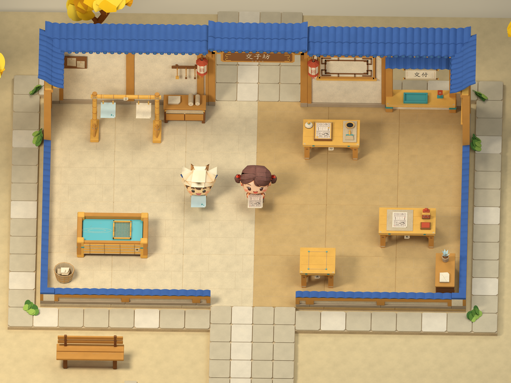
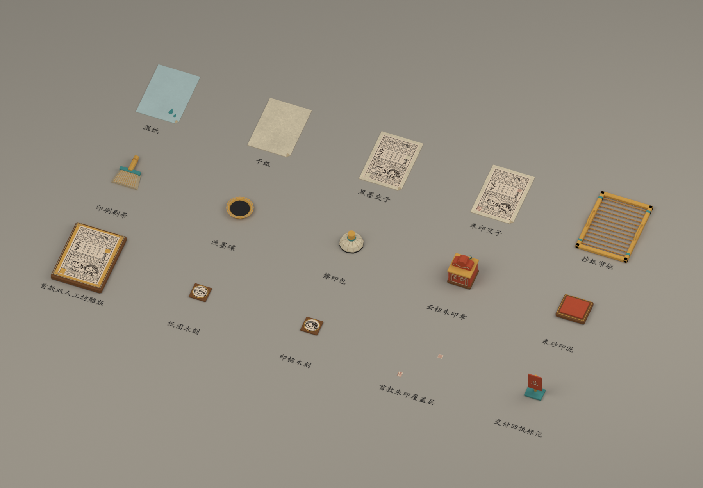
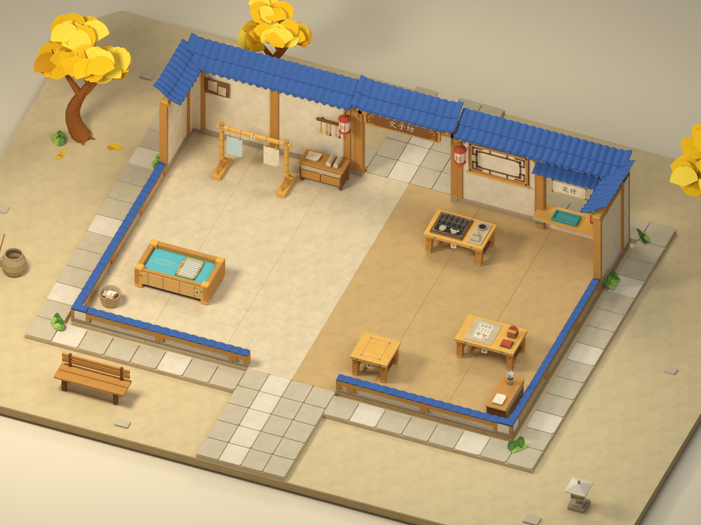
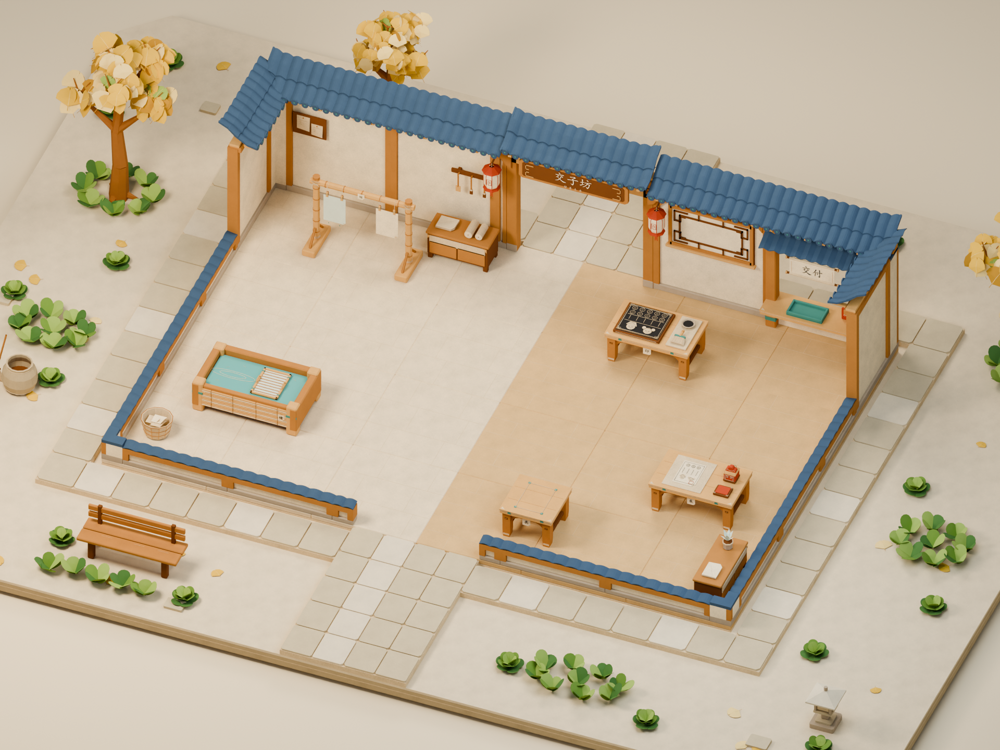
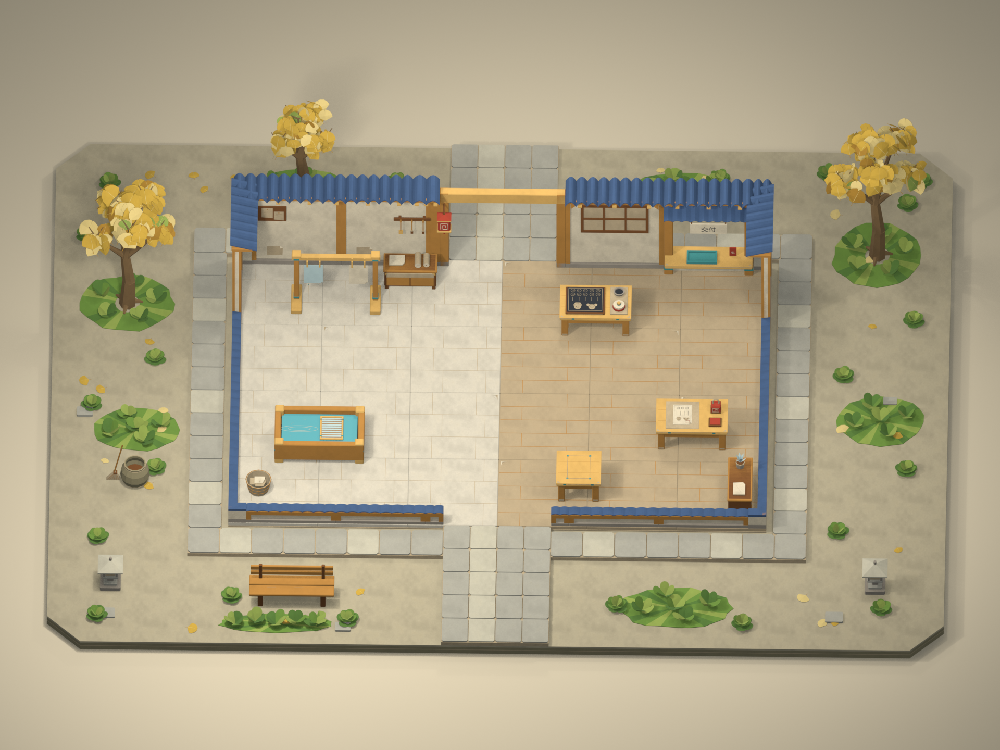

# 交子赶工记

**交个纸友，一起开工。** 架空宋代纸艺世界中的同机双人合作游戏：室外抄纸、晾干，进入印坊印刷、盖印，再交付含两位所选工匠形象的组合交子。

这里是**玩法、美术和开发交接资料仓库**，包含第一关 Blender 场景、两套已绑骨角色与动画、独立纸艺道具和美术组合展示，仍不是可直接运行的 Unity 工程。Unity 灰盒由另一位开发者维护；本仓负责设计规则、任务对齐、素材制作与交付记录。先完成第一关，再按确认范围扩充角色、普通关和 Boss。

当前规则基线为单件持物、单份订单、五工位加单槽共享台、双槽晾纸；角色组合不区分左右顺序、不允许重复角色。完整规则与数值以[当前游戏设计文档](01_游戏开发/Docs/参考文档_20261110/交子赶工记完整游戏设计文档.md)及[交接摘要](01_游戏开发/Docs/新窗口交接_游戏开发_v01_20261110.md)为准。

**快速索引：** [角色、道具与整合](#characters-props) · [最新场景与图片](#latest) · [玩法与任务文档](#docs) · [目录说明](#contents) · [历史美术来源](#references) · [完成状态](#status) · [协作方式](#workflow)

## 最新交付入口

当前批次：2026-11-11，角色、道具与组合展示 v01，环境场景 v05。**v05 已完成金黄银杏、贴墙纸草与鲜明配色，7 张正式渲染和 52 项资产检查全部完成。** v04 及更早版本完整保留。内场 12 × 8 m、五工位加共享台、7 组接口和 2.4 m 主通道保持；Unity 运行联调仍未验收。

### 首批角色、首关道具与组合展示 v01

[本批 F 任务与接入说明](01_游戏开发/Docs/首关角色与道具整合_v01_20261111.md) · [角色来源与固定提交](01_游戏开发/Imports/角色源仓_20261111/README.md) · [来源 SHA-256 清单](01_游戏开发/Imports/角色源仓_20261111/source_manifest.json)

**本批已完成 2 角色、10 个动作片段、15 件道具、1 个组合场景和 9 张实际预览。角色 138 项、道具 229 项、组合 22 项资产检查全部通过。** 角色主贴图从 4096 降为 2048，GLB 使用 JPEG 95，约 1.79／1.68 MiB；组合场景仅合并字节一致的贴图，84 张减少至 37 张。Work 是 P0 通用加工姿态，具体工位工具接触及 Unity 运行联调仍待验收。

| 入口 | 有什么 |
|---|---|
| **[两角色模型包](01_游戏开发/Models/首批角色_v01_20261111/)** | 纸团 `zhituan`、印桃 `yintao`；各一份 BLEND、GLB、FBX；保留源网格与权重，身高统一 1.2 m；各含 Idle、Walk、CarryIdle、CarryWalk、Work |
| [纸团 BLEND](01_游戏开发/Models/首批角色_v01_20261111/角色_纸团_整合_v01_20261111.blend) · [GLB](01_游戏开发/Models/首批角色_v01_20261111/角色_纸团_整合_v01_20261111.glb) · [FBX](01_游戏开发/Models/首批角色_v01_20261111/角色_纸团_整合_v01_20261111.fbx) | 纸帽男孩；24 骨，含原 22 骨与 PalmCenter／HoldPoint；源码见[角色制作脚本](01_游戏开发/Scripts/Blender/角色整合_v01_20261111/) |
| [印桃 BLEND](01_游戏开发/Models/首批角色_v01_20261111/角色_印桃_整合_v01_20261111.blend) · [GLB](01_游戏开发/Models/首批角色_v01_20261111/角色_印桃_整合_v01_20261111.glb) · [FBX](01_游戏开发/Models/首批角色_v01_20261111/角色_印桃_整合_v01_20261111.fbx) | 红衣双髻女孩；独立骨架，饰物骨与纸团不同，不按相同骨数自动互换 Avatar |
| [角色接口说明](01_游戏开发/Models/首批角色_v01_20261111/角色接口说明_v01_20261111.md) · [138 项复导检查](01_游戏开发/Models/首批角色_v01_20261111/角色复导核验_v01_20261111.json) · [角色制作报告](01_游戏开发/Models/首批角色_v01_20261111/角色整合报告_v01_20261111.json) | 实际检查 BLEND／GLB／FBX、骨骼、权重、动作、循环和贴图；印桃原网格 1 个重复三角被 Blender 回导合并，差异有索引证据 |
| [纸团三视图](01_游戏开发/Models/首批角色_v01_20261111/预览_纸团_三视图_v01_20261111.png) · [印桃三视图](01_游戏开发/Models/首批角色_v01_20261111/预览_印桃_三视图_v01_20261111.png) · [双人持纸检查](01_游戏开发/Models/首批角色_v01_20261111/预览_双人持纸验证_v01_20261111.png) · [通用加工示意](01_游戏开发/Models/首批角色_v01_20261111/预览_双人通用加工示意_v01_20261111.png) | 角色模型的实际 Blender 预览，源稿与原始模型保留 |
| **[15 件首关道具](01_游戏开发/Models/首关道具_v01_20261111/)** · [独立 GLB 目录](01_游戏开发/Models/首关道具_v01_20261111/GLB/) | 湿纸、干纸、黑票、朱票 4 态；帘框、刷子、墨碟、擦印包、印章、印泥盒 6 工具；雕版 1、双人木刻 2、朱印层 1、回执标记 1 |
| [道具 BLEND](01_游戏开发/Models/首关道具_v01_20261111/首关纸艺道具包_v01_20261111.blend) · [资产清单](01_游戏开发/Models/首关道具_v01_20261111/资产清单_v01_20261111.json) · [纸张状态接口](01_游戏开发/Models/首关道具_v01_20261111/纸张状态接口_v01_20261111.json) | 单张纸 .42 × .60 m、帘框 .52 × .70 m、底面中心原点；工具留在工位，只有四纸态可进入单件持物槽 |
| [道具制作与接入说明](01_游戏开发/Models/首关道具_v01_20261111/道具制作与接入说明_v01_20261111.md) · [229 项实测检查](01_游戏开发/Models/首关道具_v01_20261111/道具实测验证_v01_20261111.json) · [黑票／朱票分层预览](01_游戏开发/Models/首关道具_v01_20261111/预览_黑票与朱票分层_v01_20261111.png) | 15 GLB 逐件复导通过；检查尺寸、零位根、锚点、权属标记、贴图、法线及黑票避开两处朱印 |
| **[首关组合 BLEND](01_游戏开发/Models/首关整合_v01_20261111/首关_角色道具整合_v01_20261111.blend)** · [制作说明](01_游戏开发/Models/首关整合_v01_20261111/制作说明_首关整合_v01_20261111.md) · [整合核验](01_游戏开发/Models/首关整合_v01_20261111/整合核验_v01_20261111.json) | 原 v05 环境中加入两角色、11 个工位道具实例与两张手持纸；旧示意工具在副本隐藏，21 个游戏接口保持 |
| [双人单张持物近景](01_游戏开发/Models/首关整合_v01_20261111/预览_双人单张持物_v01_20261111.png) · [工位道具近景](01_游戏开发/Models/首关整合_v01_20261111/预览_工位道具整合_v01_20261111.png) | 实际 Blender 渲染，检查握持、纸纹、台高与工作台可读性 |

角色来自用户指定源仓的固定版本 `86562a37fb6cf75f0ea41419b072b4129f207538`。Walk 在源腿步基础上重定时并增加摆臂，CarryWalk 保留源循环并适配单张持纸，其余动作另行制作或从站姿派生。首款票采用已确认的纸团＋印桃原图，黑墨与两个朱印区域按 UV 分层，属于首款组合，不代表十五款票已制作。

角色与道具均为独立美术资产；本组合文件展示多种加工状态，**不是新一局初始库存，也不是已接入的 Unity 游戏**。持物对象挂到骨骼 HoldPoint；所有权、计分、计时与状态转换由程序维护。具体文件哈希、复导记录与任务验收边界见本批交接文档。

[整批文件与索引核对](01_游戏开发/Models/首关整合_v01_20261111/交付文件核对_v01_20261111.json)汇总 389 项资产检查、9 张预览、链接存在性与组合源文件哈希。

### 首关场景模型 v05：金黄银杏与贴墙纸草

[v05 制作说明与任务对应](01_游戏开发/Models/首关场景_v05_20261111/制作说明_首关场景_v05_20261111.md) · [生成与核验脚本](01_游戏开发/Scripts/Blender/首关场景_v05_20261111/) · [用户确认的树与草参考](01_游戏开发/Art/场景关卡/首关植被色彩参考_v01_20261111/用户参考_银杏树与贴墙纸草_v01_20261111.png) · [参考来源](01_游戏开发/Art/场景关卡/首关植被色彩参考_v01_20261111/来源说明.md)

| 交付入口 | 内容与当前状态 |
|---|---|
| [Blender 源文件](01_游戏开发/Models/首关场景_v05_20261111/首关_开张第一单_v05_20261111.blend) · [GLB](01_游戏开发/Models/首关场景_v05_20261111/首关_开张第一单_v05_20261111.glb) | 源文件后台复开；GLB 896/896 网格、24 张图像和 23 个 Normal Map 节点复导通过 |
| [纸坊主效果](01_游戏开发/Models/首关场景_v05_20261111/预览_纸坊主效果_v05_20261111.png) · [外景总览](01_游戏开发/Models/首关场景_v05_20261111/预览_外景总览_v05_20261111.png) | 正式渲染已检查，金黄、蓝瓦、暖木与绿色鲜明，保留纸质层次 |
| [游戏机位](01_游戏开发/Models/首关场景_v05_20261111/预览_游戏机位_v05_20261111.png) · [俯视](01_游戏开发/Models/首关场景_v05_20261111/预览_俯视_v05_20261111.png) · [纸感细节](01_游戏开发/Models/首关场景_v05_20261111/预览_纸感细节_v05_20261111.png) | 已渲染；内场布局、21 个游戏接口与原游戏相机保持 |
| **[银杏庭院近景](01_游戏开发/Models/首关场景_v05_20261111/预览_银杏庭院_v05_20261111.png)** · **[贴墙纸草近景](01_游戏开发/Models/首关场景_v05_20261111/预览_纸片草丛_v05_20261111.png)** | 3 弯干银杏／165 片大扇叶＋18 片近树落叶；9 簇／110 片低矮圆叶纸草，分布于 4 墙角、2 墙脚、3 树根；已视觉检查 |
| [v05 核验 JSON](01_游戏开发/Models/首关场景_v05_20261111/场景核验_v05_20261111.json) | 52 项全部通过，含植被数量／位置／减量、净通道、游戏接口、7 图尺寸与 GLB 复导；9 个模型及图片文件保留 SHA-256 |

已交付 10 个主文件及说明，7 张正式预览均为 1920 × 1440。草叶从 v04 的 630 片减为 110 片，减少 82.54%，集中贴墙与树根。场景共 1043 个对象、903 个网格对象；使用 Blender 5.3.0、Cycles CUDA GPU、40 samples、OpenImageDenoise，色彩管理为 **Standard／None／曝光 0**。本轮为 F15 外观更新，22 个外围根均非交互；源文件仅后台复开，未 GUI 重载，Unity 未测试。

### 首关场景模型 v04：保留的暖色纸坊与宣纸版

[v04 制作说明与任务对应](01_游戏开发/Models/首关场景_v04_20261111/制作说明_首关场景_v04_20261111.md) · [本轮脚本](01_游戏开发/Scripts/Blender/首关场景_v04_20261111/) · [风格来源：敞口概念图](03_历史成果/原工作区/output/jiaozi-gangongji-visual-kit-20261103-v2/02_游戏概念图_敞口修正版.png)

| 交付入口 | 内容与当前状态 |
|---|---|
| [Blender 源文件](01_游戏开发/Models/首关场景_v04_20261111/首关_开张第一单_v04_20261111.blend) · [GLB](01_游戏开发/Models/首关场景_v04_20261111/首关_开张第一单_v04_20261111.glb) | 源文件后台复开；GLB 963/963 网格、24 张图像和 23 个 Normal Map 节点复导通过 |
| [纸坊主效果](01_游戏开发/Models/首关场景_v04_20261111/预览_纸坊主效果_v04_20261111.png) · [外景总览](01_游戏开发/Models/首关场景_v04_20261111/预览_外景总览_v04_20261111.png) | Cycles 暖色纸艺光照；曲檐叠瓦、回纹花格、附墙牌匾与双宫灯，新增主效果机位不替换原游戏相机 |
| **[纸感细节近景](01_游戏开发/Models/首关场景_v04_20261111/预览_纸感细节_v04_20261111.png)** · [游戏机位](01_游戏开发/Models/首关场景_v04_20261111/预览_游戏机位_v04_20261111.png) · [俯视](01_游戏开发/Models/首关场景_v04_20261111/预览_俯视_v04_20261111.png) | 纸浆与随机短纤维近景可读，竹帘绳扎、榫卯木刻和篆印卷轴结构已制作；主要工作台清楚，明显共面黑块已修正 |
| [银杏庭院](01_游戏开发/Models/首关场景_v04_20261111/预览_银杏庭院_v04_20261111.png) · [纸片草丛](01_游戏开发/Models/首关场景_v04_20261111/预览_纸片草丛_v04_20261111.png) | 3 棵银杏／420 片扇叶；22 簇独立纸草／305 片叶及 8 组纸草地／65 簇／325 片叶，保留圆叶薄纸片、去掉棋盘拼色圆盘底 |
| [v04 核验 JSON](01_游戏开发/Models/首关场景_v04_20261111/场景核验_v04_20261111.json) | 49 项全部通过：占地、台高、21 个游戏接口、通道、真实门饰净口、7 张图片尺寸及 GLB 贴图法线复导等 |

本轮共 1131 个对象、970 个网格对象；已交付 10 个主文件及说明，7 张预览均为 1920 × 1440。使用 Blender 5.3.0、Cycles CUDA GPU、40 samples、OpenImageDenoise、AgX Medium High Contrast、曝光 +0.35。主效果与纸感近景已视觉检查，源文件仅后台复开，未 GUI 重载。纸坊为架空古代纸艺风格；工具附件高度随造型调整，基础台高、占地和操作节点分别核验。场景不含可玩角色、控制器或 Unity 运行验收。

### 首关场景模型 v03：保留的外围景物版

[v03 制作说明与范围](01_游戏开发/Models/首关场景_v03_20261110/制作说明_首关场景_v03_20261110.md) · [本轮脚本](01_游戏开发/Scripts/Blender/首关场景_v03_20261110/)

| 交付入口 | 内容与当前状态 |
|---|---|
| [Blender 源文件](01_游戏开发/Models/首关场景_v03_20261110/首关_开张第一单_v03_20261110.blend) · [GLB](01_游戏开发/Models/首关场景_v03_20261110/首关_开张第一单_v03_20261110.glb) | 源文件后台复开；GLB 749/749 网格无缺失，24 张贴图与 23 个 Normal Map 节点复导成功 |
| [游戏机位](01_游戏开发/Models/首关场景_v03_20261110/预览_游戏机位_v03_20261110.png) · [俯视](01_游戏开发/Models/首关场景_v03_20261110/预览_俯视_v03_20261110.png) · [纸感细节](01_游戏开发/Models/首关场景_v03_20261110/预览_纸感细节_v03_20261110.png) | 已渲染，原游戏主相机与工位接口保持 |
| [外景总览](01_游戏开发/Models/首关场景_v03_20261110/预览_外景总览_v03_20261110.png) · [银杏庭院](01_游戏开发/Models/首关场景_v03_20261110/预览_银杏庭院_v03_20261110.png) · [纸片草丛近景](01_游戏开发/Models/首关场景_v03_20261110/预览_纸片草丛_v03_20261110.png) | 已渲染及视觉检查；6 张预览均为 1920 × 1440，外景展示不替换主相机 |
| [v03 核验 JSON](01_游戏开发/Models/首关场景_v03_20261110/场景核验_v03_20261110.json) | 45 项通过：内场与入口、草形及非交互标记、相机、材质和节点复导等 |

外围已制作 20 × 15 m 纸层地台、3 棵银杏／420 片扇叶、22 簇圆叶纸片草／305 片叶、8 片成组草地／40 簇／200 片叶，以及 96 块地砖、30 片落叶和少量庭院陈设。草形依据[用户上传参考](01_游戏开发/Art/场景关卡/首关纸片草丛参考_v01_20261110/用户参考_圆叶纸片草丛_v01_20261110.png)，采用圆润薄纸片、浅折痕与深浅绿叠色；[来源说明](01_游戏开发/Art/场景关卡/首关纸片草丛参考_v01_20261110/来源说明.md)保留。全部 43 个外景根非交互；本轮后台制作验证，未在 GUI 重载。

### 首关场景模型 v02：保留的纸感陈设版

[制作说明与检查要求](01_游戏开发/Models/首关场景_v02_20261110/制作说明_首关场景_v02_20261110.md) · [本轮脚本](01_游戏开发/Scripts/Blender/首关场景_v02_20261110/)

v02 保留纸质材质与内场陈设基础；外围环境从 v03 加入，最新成品见 v05。

| 交付入口 | 内容与当前状态 |
|---|---|
| [Blender 场景源文件](01_游戏开发/Models/首关场景_v02_20261110/首关_开张第一单_v02_20261110.blend) · [GLB 导出](01_游戏开发/Models/首关场景_v02_20261110/首关_开张第一单_v02_20261110.glb) | 源文件后台复开；GLB 566/566 网格无缺失，13 张贴图与 12 个 Normal Map 节点复导成功 |
| [游戏机位](01_游戏开发/Models/首关场景_v02_20261110/预览_游戏机位_v02_20261110.png) · [俯视](01_游戏开发/Models/首关场景_v02_20261110/预览_俯视_v02_20261110.png) · [纸感细节](01_游戏开发/Models/首关场景_v02_20261110/预览_纸感细节_v02_20261110.png) | 三张 Blender 实际渲染，均为 1792 × 1280；游戏机位与纸感近景已检查 |
| [场景核验 JSON](01_游戏开发/Models/首关场景_v02_20261110/场景核验_v02_20261110.json) | 35 项通过，含装饰占地、站位间距、不可交互标记、GLB 贴图／法线往返与文件 SHA-256 |

本轮保留 6 套工位、7 个独立操作目标和 2.4 m 主通道；新增 5 组柜子、纸篓与墙饰仅作陈设。低饱和地面和安静的家具配色突出较明亮的主工作台，不增加生产步骤。v02 已后台复开，未在 Blender GUI 重载；不含可玩角色或运行逻辑。

### 首关场景模型 v01：保留的基础版

v01 的基础模型、两张渲染与核验结果保留供对照，最新模型、纸感与陈设见 v05。

| 交付入口 | 内容 |
|---|---|
| [Blender 场景源文件](01_游戏开发/Models/首关场景_v01_20261110/首关_开张第一单_v01_20261110.blend) | 24 地块、六工位、双槽晾架及独立工具与锚点，可编辑 |
| [GLB 导出](01_游戏开发/Models/首关场景_v01_20261110/首关_开张第一单_v01_20261110.glb) | 398 个网格重新导入无缺失，关键根点与锚点坐标比对通过 |
| [游戏机位渲染](01_游戏开发/Models/首关场景_v01_20261110/预览_游戏机位_v01_20261110.png) · [俯视渲染](01_游戏开发/Models/首关场景_v01_20261110/预览_俯视_v01_20261110.png) | Blender 实际输出，均为 1792 × 1280 |
| [模型制作说明](01_游戏开发/Models/首关场景_v01_20261110/制作说明_首关场景_v01_20261110.md) | 实际结构、操作侧、锚点、检查范围和 F15／F04—F09 对应 |
| [场景核验 JSON](01_游戏开发/Models/首关场景_v01_20261110/场景核验_v01_20261110.json) | 29 项检查、静态可达性结果、文件 SHA-256；Unity 测试为 false |
| [生成与检查脚本](01_游戏开发/Scripts/Blender/首关场景_v01_20261110/) | [build_scene.py](01_游戏开发/Scripts/Blender/首关场景_v01_20261110/build_scene.py)、建筑／工位／辅助模块及 [validate_scene.py](01_游戏开发/Scripts/Blender/首关场景_v01_20261110/validate_scene.py) |

场景没有中央隔墙，左右两区贯通；门框在后墙，前沿另留入口。7 个独立操作目标对应 6 套工位，其中晾架 A/B 各自独立。票面和角色肖像为几何示意，**不含可玩角色模型、动画或玩家控制器**。静态路径检查使用名义占地与简化围墙，不代替 Unity 物理或双人会车。

### 首关三视图 v02

以下正视、右视、俯视 PNG 保留为设计来源；当前建模以尺寸 JSON 和模型说明为依据，不按图中像素测量尺寸。三视图中的“待确认后建模”为生成时记录，本轮已按用户后续明确建模指令推进。

[打开完整目录](01_游戏开发/Art/场景关卡/首关三视图_v02_20261110/) · [制作说明、尺寸与 F 任务对应](01_游戏开发/Art/场景关卡/首关三视图_v02_20261110/制作说明_三视图_v02_20261110.md) · [尺寸与布局 JSON](01_游戏开发/Art/场景关卡/首关三视图_v02_20261110/尺寸与布局_v02_20261110.json) · [生成提示词](01_游戏开发/Art/场景关卡/首关三视图_v02_20261110/prompts_三视图_v02_20261110.json)

| 编号 | 图片索引 | 内容 |
|---|---|---|
| 01 | [墙体模块三视图](01_游戏开发/Art/场景关卡/首关三视图_v02_20261110/01_墙体模块三视图_v02_20261110.png) | 素墙、窗墙、转角接头 |
| 02 | [木构模块三视图](01_游戏开发/Art/场景关卡/首关三视图_v02_20261110/02_木构模块三视图_v02_20261110.png) | 柱、梁、贯通门框 |
| 03 | [地面与屋檐三视图](01_游戏开发/Art/场景关卡/首关三视图_v02_20261110/03_地面与屋檐三视图_v02_20261110.png) | 纸院地面、印坊地面、低前墙、檐片 |
| 04 | [纸院与共享台三视图](01_游戏开发/Art/场景关卡/首关三视图_v02_20261110/04_纸院与共享台三视图_v02_20261110.png) | 抄纸槽、双槽晾架、单槽共享台 |
| 05 | [印坊工位三视图](01_游戏开发/Art/场景关卡/首关三视图_v02_20261110/05_印坊工位三视图_v02_20261110.png) | 印刷台、盖印台、交付窗口 |
| 06 | [首关场景三视图](01_游戏开发/Art/场景关卡/首关三视图_v02_20261110/06_首关场景三视图_v02_20261110.png) | 左纸院、右印坊的整关正视、右视、俯视 |

### 比例与风格参考 v01

v01 保留为效果和风格来源，不覆盖，也不代替 v02 的三视图确认。

| 图片 | 用途 |
|---|---|
| [建筑模块尺寸图](01_游戏开发/Art/场景关卡/首关比例确认_v01_20261110/01_建筑模块尺寸图_v01_20261110.png) | 建筑模块外观与尺寸提案 |
| [工位角色比例图](01_游戏开发/Art/场景关卡/首关比例确认_v01_20261110/02_工位角色比例图_v01_20261110.png) | 五工位、共享台与角色尺度关系 |
| [首关整体效果图](01_游戏开发/Art/场景关卡/首关比例确认_v01_20261110/03_首关整体效果图_v01_20261110.png) | 纸艺风格、配色、敞口建筑与游戏机位参考 |

[v01 制作说明](01_游戏开发/Art/场景关卡/首关比例确认_v01_20261110/制作说明_场景关卡比例_v01_20261110.md)

### 方形 Logo v01

[方形 Logo 图片](01_游戏开发/Art/品牌标识/方形Logo_v01_20261110/Logo_交子赶工记_正方形_v01_20261110.png) · [制作说明](01_游戏开发/Art/品牌标识/方形Logo_v01_20261110/制作说明_方形Logo_v01_20261110.md)

此处为本轮方形标识入口；采用状态按制作说明及用户确认记录管理，历史 Logo 保留。

## 玩法与协作资料索引

| 资料 | 内容与读取时机 |
|---|---|
| 本地总库 `AGENTS.md` | 工作根目录、文件安全、美术约定与 GitHub 同步要求；当前未纳入本 Git 仓库 |
| 本地总库 `README.txt` | 总库原始目录说明、迁移与归档信息；保留历史状态，当前未纳入本 Git 仓库 |
| [新窗口开发交接 v01](01_游戏开发/Docs/新窗口交接_游戏开发_v01_20261110.md) | 接续工作的总入口，列明规则基线、完整资料路径、灰盒所在地与进度来源 |
| [完整游戏设计文档](01_游戏开发/Docs/参考文档_20261110/交子赶工记完整游戏设计文档.md) | 玩家流程、交互、工序、订单、角色、关卡、Boss、收藏与验收 |
| [程序与美术分工及资产清单](01_游戏开发/Docs/参考文档_20261110/程序与美术分工及资产清单.md) | 程序、美术、动画、音频的交付内容与首组比例联调 |
| [开发颗粒度对齐表 v02：F01—F20](01_游戏开发/Docs/开发颗粒度对齐表_v02_20261110.md) | 按玩家行为对应程序产出、美术数量、接口和验收的任务索引 |
| [首关角色与道具整合 v01](01_游戏开发/Docs/首关角色与道具整合_v01_20261111.md) | 两角色与15道具的来源、文件、尺度、持物协议、F02—F09及F15交接与待联调用例 |

F01—F15 覆盖第一关从标题、选角、操作与工序，到结算、保存和场景的完整闭环。F16—F18 为角色技能、普通关及组合收藏扩充，F19—F20 为 Boss 救票和废票回收。技能、完整关卡和 Boss 参数按拟案管理，不因出现在设计文档中就视为已实现。

首批角色为纸团、印桃。六角色正式名为纸团、印桃、泡泡、递蕉、墨墩、烘栗；Boss 为四足纸兽墨大嘴。历史图片内可能仍有旧名，按制作说明和稳定 ID 对照使用。

## 仓库里有什么

| 目录或文件 | 用途 |
|---|---|
| 本地 `00_项目管理` | 历史对话、来源记录、逐文件校验和迁移审计，按历史只读资料管理；未纳入本 Git 仓库 |
| [01_游戏开发](01_游戏开发/) | 新增开发内容和加工版本的工作区 |
| [01_游戏开发/Art](01_游戏开发/Art/) | 新加工美术、场景三视图、比例确认和品牌图稿 |
| [01_游戏开发/Models](01_游戏开发/Models/) | 首关场景、绑骨角色与动画、独立道具、组合 BLEND、GLB／FBX、实际渲染与核验记录 |
| [01_游戏开发/Scripts](01_游戏开发/Scripts/) | Blender 场景生成、模块制作与核验脚本；不是独立 Unity 工程 |
| [01_游戏开发/Docs](01_游戏开发/Docs/) | 玩法、规范、任务、制作与交接文档 |
| [01_游戏开发/Imports](01_游戏开发/Imports/) | 外部资产来源、固定提交与哈希清单；原角色仓本地只读克隆不重复提交 |
| [02_美术资源](02_美术资源/) | AI 生成原图与历次迭代，保留原始素材 |
| [03_历史成果](03_历史成果/) | 旧工作区成果与交付归档；GitHub 已收录部分当前参考 PNG，本地总库还保留完整归档 |
| 本地 `04_原始参考资料` | 研报、产品资料及用户参考图等历史输入；未纳入本 Git 仓库 |
| 本地 `素材总览.html` | 本地总库的离线素材总览，未纳入本 Git 仓库；并非在线游戏 |

## 美术参考的使用顺序

当前查看角色和道具先看**首关整合 v01 → 首批角色 v01／首关道具 v01**；查看建筑与环境先看 **首关模型 v05 → v04 暖色纸坊版 → v03 外围景物版 → v02 纸感陈设版 → v01 基础模型 → v02 三视图及尺寸 JSON → v01 比例与效果图**。各类资产版本分别管理，整合 v01 不覆盖环境 v05。若需查角色、票面、UI 或历史造型，按下列用途找来源，不只看文件修改时间。

| 参考包 | 主要内容 | 使用说明 |
|---|---|---|
| [敞口视觉套件 v2](03_历史成果/原工作区/output/jiaozi-gangongji-visual-kit-20261103-v2/) | 当前名称、历史 Logo、海报、敞口概念图、地图／选角／收藏／双人游玩 UI | 场景用敞口结构，UI 是整屏视觉参考；原包 `版本说明.txt` 在本地总库 |
| [角色与交子制作资产](03_历史成果/原工作区/output/jiaozi-production-assets-20261103/) | 六角色与 Boss 多视图、组合交子和固定底版 | 图中文字旧名按文件名与说明对应；原包 `制作说明.txt` 在本地总库 |
| [工位、物料与图标参考](03_历史成果/原工作区/output/jiaozi-gangongji-assets2-20261103/) | 五工位、物料状态、表情和功能图标 | 工位数量、槽数与比例以最新规则及三视图拟案为准；原包 `制作说明.txt` 在本地总库 |
| [空台、工具与建筑模块参考](03_历史成果/原工作区/output/jiaozi-gangongji-assets3-20261103/) | 空工台、空晾架、工具、建筑模块及反馈关键画面 | 早期 2D 清单和动作图不代表当前模型或动画已完成；原包 `制作说明.txt` 在本地总库 |

## 完成状态与外部工程

| 内容 | 当前应如何理解 |
|---|---|
| 首批角色 v01 | 2 角色、各 5 动作、BLEND／GLB／FBX、4 张预览，138 项资产检查通过；Work 是通用示意，真实台面工具接触未验收 |
| 首关道具 v01 | 15 个独立 GLB、共享 BLEND、4 纸态、首款票纹与朱印分层、2 张预览，229 项检查通过 |
| 首关整合 v01 | 在 v05 副本放入两角色和新版道具，3 张实际预览、22 项复开检查通过；原21接口保持，属于美术展示，不是局内初始状态 |
| 首关模型 v05：金黄银杏与贴墙纸草 | 10 个主文件及说明已交付，7 张正式渲染、52 项资产检查通过；3 树／165 冠叶＋18 落叶，9 草簇／110 叶；已后台复开与 GLB 复导，未 GUI 重载，Unity 未验收 |
| 首关模型 v04：暖色纸坊与宣纸 | 10 个主文件及说明已交付，7 张实际渲染、49 项资产检查通过；已后台复开与 GLB 复导，未 GUI 重载，Unity 未验收 |
| 首关模型 v03：外围景物 | 9 个主文件及说明已交付，6 张实际渲染，45 项检查通过；圆叶纸片草按用户参考制作，原内场接口保持，Unity 未验收 |
| 首关模型 v02：纸感与陈设 | 6 个主文件及说明已交付，3 张实际渲染，35 项资产检查通过；GLB 贴图与法线复导成功，Unity 仍未验收 |
| 首关模型 v01 与实际渲染 | 已生成的可编辑基础静态场景；29 项资产检查通过，GLB 已重新导入；Unity 朝向、运行交互、碰撞与双人试玩未验收 |
| 本轮三视图、比例图、效果图 | PNG 设计参考，现已作为本轮建模来源；图稿和尺寸仍可调整，不是可按像素测量的施工图 |
| 历史角色多视图、道具 PNG | 静态设计参考；多视图不等于三维模型，透明通道不等于已清理完成的游戏精灵 |
| 动作、特效和整屏 UI 图 | 动作示意不等于动画序列，UI 概念图不等于可交互页面 |
| 本仓 Models／Scripts 制作目录 | 已有首关模型与 Blender 生成、核验脚本；没有 Unity 玩家控制与工位运行逻辑，不能直接当作已运行游戏 |
| 另一位开发者的 Unity 灰盒 | 文档报告双人移动、五工位、双槽干燥、递交、教学、180 秒回合、计分、暂停与重开已有灰盒，12 项规则测试通过；这些来自对方进度说明，本仓未复跑，应对接工程、提交号和测试记录 |
| [独立角色三维资产仓](https://github.com/2568383756/cartoon-character-assets) | 已从固定提交导入纸团、印桃，优化版本另存本仓 Models；源仓只读保留。骨骼动画美术整合与 Unity 运行接入分别记录 |

灰盒进度来源与限制详见[交接摘要第 7 节](01_游戏开发/Docs/新窗口交接_游戏开发_v01_20261110.md)。文档中的“我负责程序”指原文编写方的分工，不代表本素材仓已经实现相应功能。

## 如何继续协作

1. 接续本地总库时先读根目录 `AGENTS.md`、`README.txt` 和[交接摘要](01_游戏开发/Docs/新窗口交接_游戏开发_v01_20261110.md)，再按当前任务读取相关设计与制作说明。仅使用 GitHub 副本时，从本页和交接摘要进入。
2. 新文件放入 `01_游戏开发`，历史素材加工后另存版本；不覆盖原图，不按相似名称批量清理。展示名与代码稳定 ID 分开维护。
3. 沿用 F01—F20；每项记录玩家行为、程序产出、美术资产及数量、接口要求、验收情景、文件路径、版本和相关提交。
4. 当前已有首关环境、两套绑骨角色、首关道具与组合展示；后续先以角色、工位、纸张做首组 Unity 比例联调，再扩大接入。轴向转换、比例、手持点、台高、碰撞及遮挡以目标工程实测为准；代码改动在经核实的正式工程内进行。
5. 每次完成更新后，只提交本次相关文件，推送到[本 GitHub 仓库](https://github.com/2568383756/jiaozi-gangongji)，并核对远端提交。失败时保留本地提交并说明同步状态；素材仓、角色资产仓与代码仓分别记录。

仓库中的历史状态保留其原始日期；当前来源和确认结果以较新的交接说明及明确任务记录为准，不能把静态素材、文件存在、程序报告和实际运行验收混为同一完成状态。
