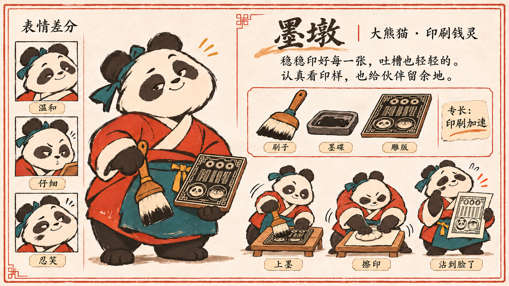
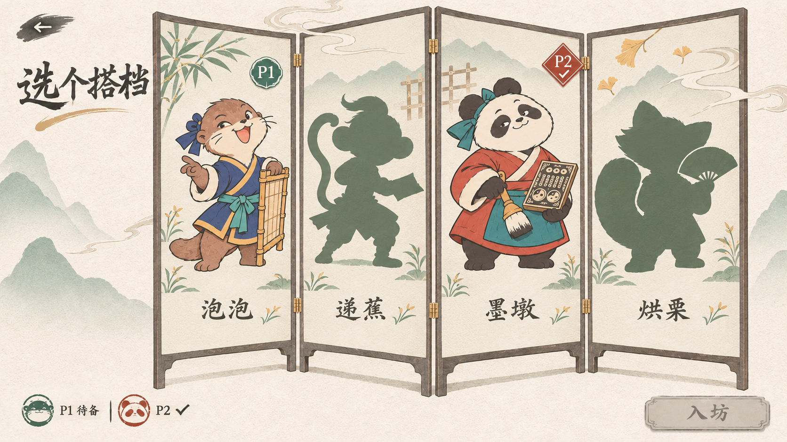
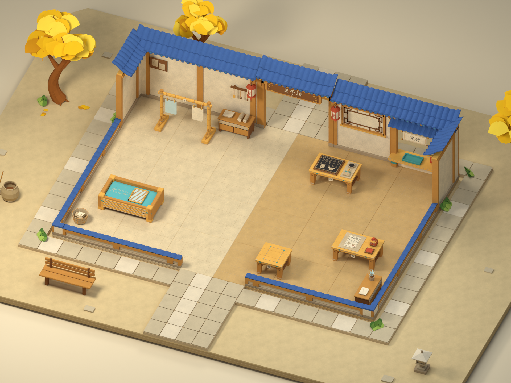
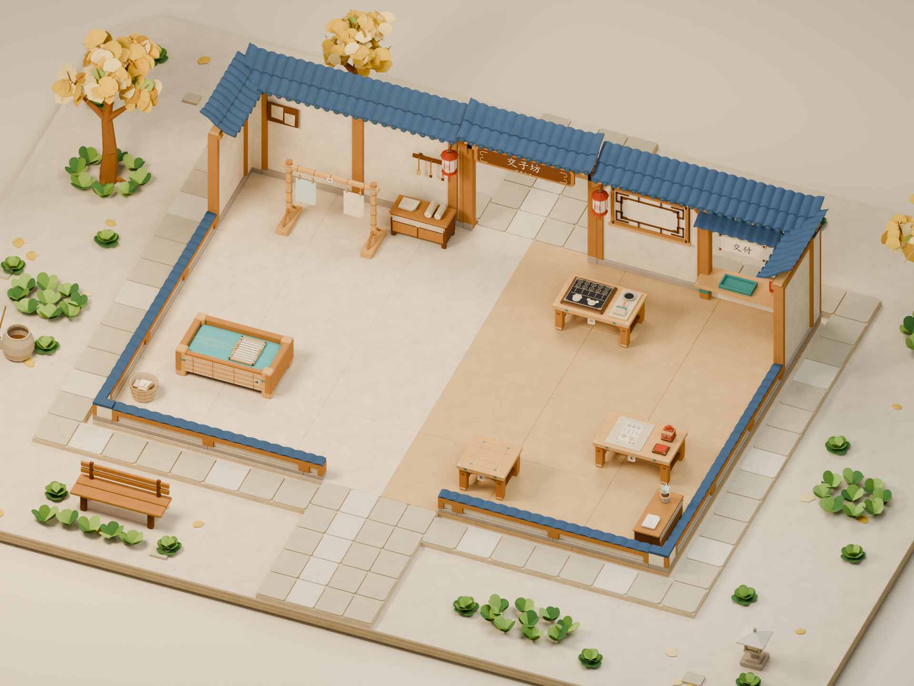
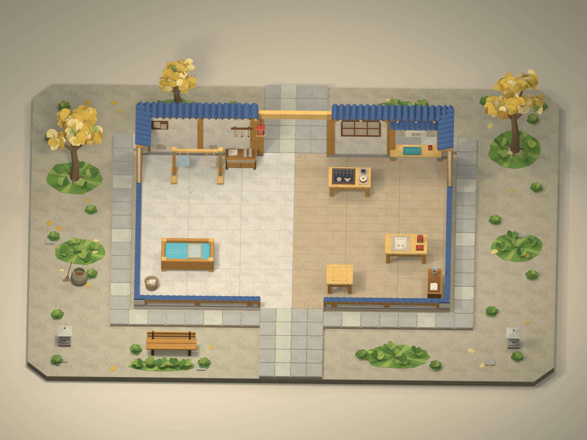

# 交子赶工记

[历史方形 Logo v01](01_游戏开发/Art/品牌标识/方形Logo_v01_20261110/Logo_交子赶工记_正方形_v01_20261110.png)：品牌名保持《交子赶工记》，图形是否适配四动物版待核对。

**交个纸友，一起开工。** 财神府纸币司的四位动物钱灵进入北宋益州忆境，在钱币长卷中面对“空白风”。双人合作抄纸、晾干、印刷、盖印和交付，通过理解与传递钱币文化恢复灵气；灵气不靠印钞刷量获得。

这里是**玩法、美术和开发交接资料仓库**，包含第一关 Blender 场景、历史两套人类绑骨角色与动画、独立纸艺道具和美术展示。Unity 灰盒由另一位开发者维护；本仓不是可直接运行的 Unity 工程。先完成第一关，再按确认范围扩充内容；旧墨大嘴 Boss 方案暂停。

当前规则保留同机双人、单件持物、单份订单、五工位加单槽共享台、双槽晾纸、既有键位与 180 秒回合。规则与数值以[四动物统一设定](01_游戏开发/Docs/设定同步_v01_20261120/世界观角色与技能统一设定_v01_20261120.md)、[F01—F20 对齐表 v03](01_游戏开发/Docs/开发颗粒度对齐表_v03_20261120.md)和[交接摘要 v02](01_游戏开发/Docs/新窗口交接_游戏开发_v02_20261120.md)为准；旧六角色文档保留为来源。

**快速索引：** [当前四动物设定](#current-setting) · [四动物手绘设定图](#animal-sheets) · [四动物双人选角图片](#animal-selection-ui) · [旧版 UI 图片](#ui-full-pages) · [历史 UI 交互草稿](#level-one-ui) · [旧人类触台记录](#contact-fit) · [角色道具历史记录](#characters-props) · [场景与历史模型](#latest) · [玩法与任务文档](#docs) · [目录说明](#contents) · [历史美术来源](#references) · [完成状态](#status) · [协作方式](#workflow)

## 当前设定与资源状态 · 2026-11-20

只保留四位动物钱灵，所有普通工序仍可由任意角色完成。用户明确技能沿用旧版本，以下为统一后的技能与联调初值。

| 正式名／稳定 ID | 形象 | 技能 |
|---|---|---|
| 泡泡／`paopao` | 水獭，女 | 自己抄纸 1.4 秒 |
| 递蕉／`dijiao` | 金丝猴，男 | 向搭档递交 2 米；工位仍 1.2 米，墙体阻隔 |
| 墨墩／`modun` | 大熊猫，女 | 自己印刷 1.4 秒 |
| 烘栗／`hongli` | 小熊猫，男 | 按住对单个湿纸槽扇风，总干燥速率为普通的 2 倍 |

四选二、不重复、不分左右，共 **6 款组合交子**。纸团、印桃退出可用名单；旧人类首票不计入新收藏，旧人类存档不映射给动物。新世界观无实体反派，墨大嘴方案仅留历史记录。玩家无实体人类角色，开场无可见人类，财神仅以声音、祥云或金印出现。

[统一设定与别名对照](01_游戏开发/Docs/设定同步_v01_20261120/世界观角色与技能统一设定_v01_20261120.md) · [新开场剧本：180 秒／12 镜](01_游戏开发/Docs/设定同步_v01_20261120/开场动画剧本_四动物统一版_v01_20261120.md) · [新窗口交接](01_游戏开发/Docs/新窗口交接_游戏开发_v02_20261120.md) · [F01—F20 任务表](01_游戏开发/Docs/开发颗粒度对齐表_v03_20261120.md)

已完成设定同步、四动物手绘设定页和五张双人选角整页视觉稿。四动物真实模型、新肖像票、可交互 UI 与新开场成片仍需制作。已有含人类的模型、图片、票面和影片保留为历史资源，不能直接当作四动物版；通用纸艺风格、场景与工具可继续评估复用。新剧本不增加跳台、中途换角或拖动木棒操作。

近期美术要求已同步：国风手绘墨线、简洁平涂、四动物体形与轮廓对比；纸卷走势连续、转折与遮挡明确，配色不全降饱和。已归档[聊天附件参考 9 张](01_游戏开发/Art/四动物聊天参考_v01_20261120/从这里开始.md)，含迭代与排版参考，不将图片里的盖章姿势当作烘栗的新技能。分享页正文未直接取得，已读同名账户聊天最近 5 轮；[来源记录](01_游戏开发/Docs/设定同步_v01_20261120/来源与核验_v01_20261120.json)说明核对范围。

[旧开场机关书 v11 制作记录](01_游戏开发/Docs/F01_开场机关书衔接与车轮优化_v11_20261113.md)保留原 56 秒成片及人物，供技术参考，不作为新世界观开场。

## 四动物手绘角色设定图 · 2026-11-20

本批生成四张完整设定页：每张含主立绘 1、表情 3、动作小剧场 3 及道具示意，以不均匀墨线、断笔和平涂加强手绘感。均为 1672×941 PNG，当前待确认；名字与旧技能沿用四动物统一设定。

| 图片 | 角色特征 |
|---|---|
| [泡泡 · 水獭](01_游戏开发/Art/四动物角色设定图_v01_20261120/01_泡泡_水獭_角色设定图_v01_20261120.png) | 靛蓝工衣、竹帘，爽快的抄纸工匠 |
| [递蕉 · 金丝猴](01_游戏开发/Art/四动物角色设定图_v01_20261120/02_递蕉_金丝猴_角色设定图_v01_20261120.png) | 金色毛发、蓝灰脸颊、长尾，急性子的递纸搭档 |
| [墨墩 · 大熊猫 · 雕版修正版](01_游戏开发/Art/四动物角色设定图_v01_20261120/03_墨墩_大熊猫_角色设定图_雕版修正_v02_20261120.png) | 朱红工衣，温和认真；薄木雕版与动物组合交子示意 |
| [烘栗 · 小熊猫](01_游戏开发/Art/四动物角色设定图_v01_20261120/04_烘栗_小熊猫_角色设定图_v01_20261120.png) | 青绿交领、大环尾、折扇，扇风晾纸专长 |

[整批图片与提示词索引](01_游戏开发/Art/四动物角色设定图_v01_20261120/从这里开始.md) · [F 编号交接](01_游戏开发/Docs/四动物角色设定图交接_v01_20261120.md) · [文件尺寸与哈希](01_游戏开发/Art/四动物角色设定图_v01_20261120/文件核对_v01_20261120.json)

墨墩根据用户反馈另存 v02：去掉鹿纹装饰牌与画架，改为平板木雕版，并统一上墨、擦印和交子印样；未采用初稿单独保留。四图是静态造型与表演稿，尚未拆头像、制成动画或模型；图内票面不是正式六组合分层资源。

## 四动物双人选角整页图片 · 总览 v04／详情 v03 · 2026-11-20

当前评审稿共 **5 张完整页面**。总览改为四扇透视折屏，人物以平涂画在屏风内：已选显现彩色、未选显示剪影，移除每栏选择按钮。详情采用大角色、书法名字、少量斜置纸卡和一句技能短文；头像改为印章质感的头部剪影。浅米灰、青绿与少量赭色保持明亮，减少密集纹理和立体浮雕感。

| 当前图片 | 内容 |
|---|---|
| [01 四角色总览 · v04](01_游戏开发/Art/四动物双人选角UI_折屏印章_v03_20261120/01_四角色总览_剪影显现_UI整页_v04_20261120.png) | 屏风内平涂人物，剪影／彩色选择状态，无每栏选择按钮 |
| [02 泡泡详情 · v03](01_游戏开发/Art/四动物双人选角UI_折屏印章_v03_20261120/02_泡泡详情_留白_UI整页_v03_20261120.png) | 水獭大预览，抄纸 1.4 秒，剪影印章导航 |
| [03 递蕉详情 · v03](01_游戏开发/Art/四动物双人选角UI_折屏印章_v03_20261120/03_递蕉详情_留白_UI整页_v03_20261120.png) | 金丝猴大预览，向搭档递交 2 米 |
| [04 墨墩详情 · v03](01_游戏开发/Art/四动物双人选角UI_折屏印章_v03_20261120/04_墨墩详情_留白_UI整页_v03_20261120.png) | 大熊猫、青绿发结与修正雕版，印刷 1.4 秒 |
| [05 烘栗详情 · v03](01_游戏开发/Art/四动物双人选角UI_折屏印章_v03_20261120/05_烘栗详情_留白_UI整页_v03_20261120.png) | 小熊猫、大环尾与折扇，单湿纸槽扇风总速率×2 |

[完整图片与提示词索引](01_游戏开发/Art/四动物双人选角UI_折屏印章_v03_20261120/从这里开始.md) · [F02 及关联任务交接](01_游戏开发/Docs/四动物双人选角UI参考重排交接_v03_20261120.md) · [沿用的双人状态合同](01_游戏开发/Art/四动物双人选角UI_v01_20261120/双人选角状态合同_v01_20261120.json) · [文件核对](01_游戏开发/Art/四动物双人选角UI_折屏印章_v03_20261120/文件核对_v04_20261120.json)

五张当前图均为 1672×941、不透明 RGB PNG，由内置 image_gen 生成。P1 圆标、P2 菱标与勾号保留；图中显现只表示已选，准备独立判断。详情仍保留模型效果预览下方选择按钮；实际四动物模型、UI 拆件与运行功能未制作。[旧厚框版](01_游戏开发/Art/四动物双人选角UI_v01_20261120/从这里开始.md)及本轮暗色初稿保留对照，不作为当前入口。

## 旧版 UI 整页图片 · v02 / 2026-11-13

**保留 7 张旧人类版 UI 图片，角色与票面待替换。** 层叠纸框、金色压边、朱红／青绿按钮和鲜明配色可作风格参考；画中的纸团、印桃、首票与 1/1 数量属于旧批次，不定义新四动物选角或 6 款收藏。

| 整页图片 | 内容 |
|---|---|
| [01 首关关卡选择](01_游戏开发/Art/UI_整页设计_v02_20261113/01_首关关卡选择_UI整页_v02_20261113.png) | 单个首关入口、纸艺地图、右侧详情与进入工坊按钮 |
| [02 局内合作 HUD](01_游戏开发/Art/UI_整页设计_v02_20261113/02_局内合作HUD_UI整页_v02_20261113.png) | 单份订单、倒计时、双槽进度、分数和两位玩家持物状态 |
| [03 标题首页](01_游戏开发/Art/UI_整页设计_v02_20261113/03_标题首页_UI整页_v02_20261113.png) | 两位工匠共持交子，开工、收藏、设置与退出入口 |
| [04 双人选角](01_游戏开发/Art/UI_整页设计_v02_20261113/04_双人选角_UI整页_v02_20261113.png) | 纸团／印桃双角色纸卡、玩家确认和进入工坊按钮 |
| [05 暂停设置](01_游戏开发/Art/UI_整页设计_v02_20261113/05_暂停设置_UI整页_v02_20261113.png) | 压暗场景上的纸框弹窗，继续、重开、音量和显示设置 |
| [06 首关结算](01_游戏开发/Art/UI_整页设计_v02_20261113/06_首关结算_UI整页_v02_20261113.png) | 70 分、交付 4 张／完成 3 单、1 星及首款收藏提示 |
| [07 交子收藏](01_游戏开发/Art/UI_整页设计_v02_20261113/07_交子收藏_UI整页_v02_20261113.png) | 首款纸团×印桃组合交子，纸册展示与 1/1 收藏进度 |
| [使用与来源说明](01_游戏开发/Art/UI_整页设计_v02_20261113/从这里开始.md) · [F 编号交接](01_游戏开发/Docs/首关UI整页设计_v02_20261113.md) | 七张原始输出均为 1672×941、不透明 PNG；内置 image_gen 生成 |
| [前两页提示词与来源](01_游戏开发/Art/UI_整页设计_v02_20261113/生成提示词与来源_v02_20261113.json) · [新增五页提示词](01_游戏开发/Art/UI_整页设计_v02_20261113/新增五页_生成提示词_v02_20261113.json) · [文件核对](01_游戏开发/Art/UI_整页设计_v02_20261113/文件核对_v02_20261113.json) | 原始提示词、参考路径、七张文件尺寸与 SHA-256 |

[旧人类版首关关卡选择图](01_游戏开发/Art/UI_整页设计_v02_20261113/01_首关关卡选择_UI整页_v02_20261113.png)

[旧人类版局内合作 HUD 图](01_游戏开发/Art/UI_整页设计_v02_20261113/02_局内合作HUD_UI整页_v02_20261113.png)

本批为完整画面的视觉设计，没有把整页图当作可交互页面或独立组件包。组件裁切、动态文字分离、票面黑墨／朱印分层、九宫格及正式 Unity 接入尚未完成；场景插画也不替换已校准的 Blender 关卡。

## 首关 UI 交互草稿 · v01 / 2026-11-13（保留历史）

纸艺米色、朱红、靛蓝与金黄，配合实际 v02 角色透明渲染。本批完成标题、首关入口、双人选角、教学／局内 HUD、暂停／设置、结算和首款收藏的界面样机。**下载后双击 `index.html` 即可离线浏览；GitHub 文件页显示的是源代码。** 底部“界面预览”抽屉可切换页面、模拟持物／双槽／反馈和结算，正式游戏 UI 不包含该工具。

| 内容 | 入口 |
|---|---|
| 可点击预览、使用说明 | [index.html](01_游戏开发/Art/UI_首关_v01_20261113/index.html) · [从这里开始](01_游戏开发/Art/UI_首关_v01_20261113/从这里开始.md) |
| 页面图片 | [完整预览目录](01_游戏开发/Art/UI_首关_v01_20261113/previews/) |
| 拆件与源文件 | [assets](01_游戏开发/Art/UI_首关_v01_20261113/assets/) · [资源尺寸、九宫格、来源与 SHA](01_游戏开发/Art/UI_首关_v01_20261113/assets/manifest.json) |
| 程序接入 | [F01—F15 UI 交接](01_游戏开发/Docs/首关UI交接_v01_20261113.md) · [状态与事件合同](01_游戏开发/Art/UI_首关_v01_20261113/ui_contract.json) |
| 复核与重建 | [浏览器验证记录](01_游戏开发/Art/UI_首关_v01_20261113/核验报告_v01_20261113.json) · [资源与测试脚本](01_游戏开发/Scripts/UI_首关_v01_20261113/) |

共 23 组 SVG／PNG 通用拆件、2 张透明角色图、3 张已有图片引用，共 28 张 PNG；动态文字与数值由页面生成。单件持物、单份订单、180 秒及结算收藏规则与当前首关一致。网页使用独立预览记录，音乐试听引用已有开场音轨，画布宽度设置不改变操作系统分辨率。场景为静态模型渲染，**不是 Unity 运行版本**；正式 UI Toolkit 布局和游戏事件仍由另一位开发者接入。

[旧人类版首关 UI 标题界面](01_游戏开发/Art/UI_首关_v01_20261113/previews/01_标题_1920x1080.png)

## 场景与历史模型入口

历史批次：2026-11-11，**人类角色 v02、触台整合 v02**；采用 v05 金黄银杏、贴墙纸草与鲜明配色。原两人类高 1.2 m，工位按其短臂可达范围适配，尺寸结论须用新动物模型重新验证。原环境与模型均保留；内场 12 × 8 m、五工位加共享台、7 个操作点和 2.4 m 主通道可作后续联调基线，Unity 运行联调仍未验收。

### 历史人类角色的触台比例与修正

[本批 F02—F09／F15 交接](01_游戏开发/Docs/首关触台比例与角色材质修正_v01_20261111.md) · [工位尺寸与接口说明](01_游戏开发/Models/首关工位适配_v01_20261111/工位适配与接触接口说明_v01_20261111.md) · [服装材质修正说明](01_游戏开发/Models/角色贴图修正_v01_20261111/制作说明_服装材质修正_v01_20261111.md)

这批解决旧 `.65 m` 台面偏高、站点距台沿 `.425 m` 太远，以及衣服侧腰的肤色残影。裸台顶改为 `.330 m`，薄版／垫 `.014 m` 加纸 `.006 m` 后，实际接触面为 `.350 m`；操作站位距台沿 `.240 m`。双槽晾架采用低位斜托与水平接纸条，槽间距 `1.30 m`。纸张 `.42 × .60 m` 和角色大头短身风格保持。

两角色的空心握拳已重做成封闭实心掌、圆钝指尖和短拇指，补齐内袖口，并调整触台、持纸待机与持纸走路的手腕姿势。仍沿用原骨架及纸根零挂 HoldPoint 的接口；新版具体偏移见角色说明。

| 交付入口 | 内容 |
|---|---|
| **[角色 v02 模型包](01_游戏开发/Models/首批角色_v02_20261111/)** · [接口说明](01_游戏开发/Models/首批角色_v02_20261111/角色接口说明_v02_20261111.md) | 纸团、印桃各 BLEND／GLB／FBX，服装材质修正、手型与触台姿势；保留单件持物和五类动作 |
| [新手持纸](01_游戏开发/Models/首批角色_v02_20261111/预览_新手_CarryIdle_v02_20261111.png) · [持纸走路](01_游戏开发/Models/首批角色_v02_20261111/预览_新手_CarryWalk_v02_20261111.png) · [待机](01_游戏开发/Models/首批角色_v02_20261111/预览_新手_Idle_v02_20261111.png) | 最终模型实际渲染，检查手掌、拇指、袖口和纸张位置 |
| **[新版组合 BLEND](01_游戏开发/Models/首关整合_v02_20261111/首关_触台比例整合_v02_20261111.blend)** · [静态环境 GLB](01_游戏开发/Models/首关整合_v02_20261111/首关_触台比例环境_v02_20261111.glb) | 真实场景中的角色与工作台比例；环境 GLB 不含角色，便于程序分别接入 |
| [六工位独立 GLB](01_游戏开发/Models/首关整合_v02_20261111/工位GLB/) · [尺寸配置](01_游戏开发/Scripts/Blender/首关工位适配_v01_20261111/适配尺寸配置_v01_20261111.json) | 工位根在零位，纸锚点、站位、接触面、碰撞参考与固定工具保留；不要与完整环境重复叠放 |
| [游戏机位](01_游戏开发/Models/首关整合_v02_20261111/预览_触台比例全景_v02_20261111.png) · [纸团印台](01_游戏开发/Models/首关整合_v02_20261111/预览_纸团印台接触_v02_20261111.png) · [印桃章台](01_游戏开发/Models/首关整合_v02_20261111/预览_印桃章台接触_v02_20261111.png) | 实际 Blender 场景渲染 |
| [新版侧视](01_游戏开发/Models/首关整合_v02_20261111/预览_台高侧面核对_v02_20261111.png) · [旧版同机位对照](01_游戏开发/Models/首关整合_v02_20261111/预览_旧版触台侧面对照_20261111.png) | 对比台高、手的位置、下巴空间及脚下退让 |
| [双槽低位晾纸近景](01_游戏开发/Models/首关整合_v02_20261111/预览_双槽低位晾纸_v02_20261111.png) | 两人同时站在 A／B，斜托、水平接纸条与头饰间距 |
| [纸团衣服修正](01_游戏开发/Models/角色贴图修正_v01_20261111/预览_纸团侧腰_修正后_v01_20261111.png) · [印桃衣服修正](01_游戏开发/Models/角色贴图修正_v01_20261111/预览_印桃背侧_核对_v01_20261111.png) | 清理衣片和腰带的串色，原 atlas、五官和服装主配色保留 |
| [整合与导出核验](01_游戏开发/Models/首关整合_v02_20261111/触台整合核验_v02_20261111.json) · [实际网格接触核验](01_游戏开发/Models/首关整合_v02_20261111/触台网格独立核验_v01_20261111.json) · [重建脚本](01_游戏开发/Scripts/Blender/首关整合_v02_20261111/) | 保存后复开、静态 GLB 回导、真实掌面与工位三角网格检查；详细方法及边界见各报告 |

[旧人类角色与工位触台比例图](01_游戏开发/Models/首关整合_v02_20261111/预览_触台比例全景_v02_20261111.png)

本批是实际模型与动画资源校准。Work 提供触台样本，刷墨、落章、抄纸工具的专用动作同步和 Unity 运行测试仍需接续；不能将 Blender 接触检查写成完整玩法已验收。旧版本的检查数量仍属于各自历史批次。

### 首批角色、首关道具与组合展示 v01（历史基线）

[本批 F 任务与接入说明](01_游戏开发/Docs/首关角色与道具整合_v01_20261111.md) · [角色来源与固定提交](01_游戏开发/Imports/角色源仓_20261111/README.md) · [来源 SHA-256 清单](01_游戏开发/Imports/角色源仓_20261111/source_manifest.json)

**本批已完成 2 角色、10 个动作片段、15 件道具、1 个组合场景和 9 张实际预览。角色 138 项、道具 229 项、组合 22 项资产检查全部通过。** 角色主贴图从 4096 降为 2048，GLB 使用 JPEG 95，约 1.79／1.68 MiB；组合场景仅合并字节一致的贴图，84 张减少至 37 张。Work 是 P0 通用加工姿态，具体工位工具接触及 Unity 运行联调仍待验收。

| 入口 | 有什么 |
|---|---|
| **[两角色模型包](01_游戏开发/Models/首批角色_v01_20261111/)** | 纸团 `zhituan`、印桃 `yintao`；各一份 BLEND、GLB、FBX；保留源网格与权重，身高统一 1.2 m；各含 Idle、Walk、CarryIdle、CarryWalk、Work |
| [纸团 BLEND](01_游戏开发/Models/首批角色_v01_20261111/角色_纸团_整合_v01_20261111.blend) · [GLB](01_游戏开发/Models/首批角色_v01_20261111/角色_纸团_整合_v01_20261111.glb) · [FBX](01_游戏开发/Models/首批角色_v01_20261111/角色_纸团_整合_v01_20261111.fbx) | 纸帽男孩；24 骨，含原 22 骨与 PalmCenter／HoldPoint；源码见[角色制作脚本](01_游戏开发/Scripts/Blender/角色整合_v01_20261111/) |
| [印桃 BLEND](01_游戏开发/Models/首批角色_v01_20261111/角色_印桃_整合_v01_20261111.blend) · [GLB](01_游戏开发/Models/首批角色_v01_20261111/角色_印桃_整合_v01_20261111.glb) · [FBX](01_游戏开发/Models/首批角色_v01_20261111/角色_印桃_整合_v01_20261111.fbx) | 红衣双髻女孩；独立骨架，饰物骨与纸团不同，不按相同骨数自动互换 Avatar |
| [角色接口说明](01_游戏开发/Models/首批角色_v01_20261111/角色接口说明_v01_20261111.md) · [138 项复导检查](01_游戏开发/Models/首批角色_v01_20261111/角色复导核验_v01_20261111.json) · [角色制作报告](01_游戏开发/Models/首批角色_v01_20261111/角色整合报告_v01_20261111.json) | 实际检查 BLEND／GLB／FBX、骨骼、权重、动作、循环和贴图；印桃原网格 1 个重复三角被 Blender 回导合并，差异有索引证据 |
| [纸团三视图](01_游戏开发/Models/首批角色_v01_20261111/预览_纸团_三视图_v01_20261111.png) · [印桃三视图](01_游戏开发/Models/首批角色_v01_20261111/预览_印桃_三视图_v01_20261111.png) · [双人持纸检查](01_游戏开发/Models/首批角色_v01_20261111/预览_双人持纸验证_v01_20261111.png) · [通用加工示意](01_游戏开发/Models/首批角色_v01_20261111/预览_双人通用加工示意_v01_20261111.png) | 角色模型的实际 Blender 预览，源稿与原始模型保留 |
| **[15 件首关道具](01_游戏开发/Models/首关道具_v01_20261111/)** · [独立 GLB 目录](01_游戏开发/Models/首关道具_v01_20261111/GLB/) | 湿纸、干纸、黑票、朱票 4 态；帘框、刷子、墨碟、擦印包、印章、印泥盒 6 工具；雕版 1、双人木刻 2、朱印层 1、回执标记 1 |
| [道具 BLEND](01_游戏开发/Models/首关道具_v01_20261111/首关纸艺道具包_v01_20261111.blend) · [资产清单](01_游戏开发/Models/首关道具_v01_20261111/资产清单_v01_20261111.json) · [纸张状态接口](01_游戏开发/Models/首关道具_v01_20261111/纸张状态接口_v01_20261111.json) | 单张纸 .42 × .60 m、帘框 .52 × .70 m、底面中心原点；工具留在工位，只有四纸态可进入单件持物槽 |
| [道具制作与接入说明](01_游戏开发/Models/首关道具_v01_20261111/道具制作与接入说明_v01_20261111.md) · [229 项实测检查](01_游戏开发/Models/首关道具_v01_20261111/道具实测验证_v01_20261111.json) · [黑票／朱票分层预览](01_游戏开发/Models/首关道具_v01_20261111/预览_黑票与朱票分层_v01_20261111.png) | 15 GLB 逐件复导通过；检查尺寸、零位根、锚点、权属标记、贴图、法线及黑票避开两处朱印 |
| **[首关组合 BLEND](01_游戏开发/Models/首关整合_v01_20261111/首关_角色道具整合_v01_20261111.blend)** · [制作说明](01_游戏开发/Models/首关整合_v01_20261111/制作说明_首关整合_v01_20261111.md) · [整合核验](01_游戏开发/Models/首关整合_v01_20261111/整合核验_v01_20261111.json) | 原 v05 环境中加入两角色、11 个工位道具实例与两张手持纸；旧示意工具在副本隐藏，21 个游戏接口保持 |
| [双人单张持物近景](01_游戏开发/Models/首关整合_v01_20261111/预览_双人单张持物_v01_20261111.png) · [工位道具近景](01_游戏开发/Models/首关整合_v01_20261111/预览_工位道具整合_v01_20261111.png) | 实际 Blender 渲染，检查握持、纸纹、台高与工作台可读性 |

[旧人类角色与道具整合图](01_游戏开发/Models/首关整合_v01_20261111/预览_首关双人整合_v01_20261111.png)

[旧道具总览（含人类肖像票面，待替换）](01_游戏开发/Models/首关道具_v01_20261111/预览_首关道具总览_v01_20261111.png)

历史两个人类角色来自用户指定源仓的固定版本 `86562a37fb6cf75f0ea41419b072b4129f207538`。Walk 在源腿步基础上重定时并增加摆臂，CarryWalk 保留源循环并适配单张持纸，其余动作另行制作或从站姿派生。历史首票采用当时确认的纸团＋印桃原图，黑墨与两个朱印区域按 UV 分层；该人类肖像票不计入现行六款动物组合，原文件保留待另版替换。

角色与道具均为独立美术资产；本组合文件展示多种加工状态，**不是新一局初始库存，也不是已接入的 Unity 游戏**。持物对象挂到骨骼 HoldPoint；所有权、计分、计时与状态转换由程序维护。具体文件哈希、复导记录与任务验收边界见本批交接文档。

[整批文件与索引核对](01_游戏开发/Models/首关整合_v01_20261111/交付文件核对_v01_20261111.json)汇总 389 项资产检查、9 张预览、链接存在性与组合源文件哈希。

### 首关场景模型 v05：金黄银杏与贴墙纸草

[v05 制作说明与任务对应](01_游戏开发/Models/首关场景_v05_20261111/制作说明_首关场景_v05_20261111.md) · [生成与核验脚本](01_游戏开发/Scripts/Blender/首关场景_v05_20261111/) · [用户确认的树与草参考](01_游戏开发/Art/场景关卡/首关植被色彩参考_v01_20261111/用户参考_银杏树与贴墙纸草_v01_20261111.png) · [参考来源](01_游戏开发/Art/场景关卡/首关植被色彩参考_v01_20261111/来源说明.md)

| 交付入口 | 内容与当前状态 |
|---|---|
| [Blender 源文件](01_游戏开发/Models/首关场景_v05_20261111/首关_开张第一单_v05_20261111.blend) · [GLB](01_游戏开发/Models/首关场景_v05_20261111/首关_开张第一单_v05_20261111.glb) | 源文件后台复开；GLB 896/896 网格、24 张图像和 23 个 Normal Map 节点复导通过 |
| [纸坊主效果](01_游戏开发/Models/首关场景_v05_20261111/预览_纸坊主效果_v05_20261111.png) · [外景总览](01_游戏开发/Models/首关场景_v05_20261111/预览_外景总览_v05_20261111.png) | 正式渲染已检查，金黄、蓝瓦、暖木与绿色鲜明，保留纸质层次 |
| [游戏机位](01_游戏开发/Models/首关场景_v05_20261111/预览_游戏机位_v05_20261111.png) · [俯视](01_游戏开发/Models/首关场景_v05_20261111/预览_俯视_v05_20261111.png) · [纸感细节](01_游戏开发/Models/首关场景_v05_20261111/预览_纸感细节_v05_20261111.png) | 已渲染；内场布局、21 个游戏接口与原游戏相机保持 |
| **[银杏庭院近景](01_游戏开发/Models/首关场景_v05_20261111/预览_银杏庭院_v05_20261111.png)** · **[贴墙纸草近景](01_游戏开发/Models/首关场景_v05_20261111/预览_纸片草丛_v05_20261111.png)** | 3 弯干银杏／165 片大扇叶＋18 片近树落叶；9 簇／110 片低矮圆叶纸草，分布于 4 墙角、2 墙脚、3 树根；已视觉检查 |
| [v05 核验 JSON](01_游戏开发/Models/首关场景_v05_20261111/场景核验_v05_20261111.json) | 52 项全部通过，含植被数量／位置／减量、净通道、游戏接口、7 图尺寸与 GLB 复导；9 个模型及图片文件保留 SHA-256 |

已交付 10 个主文件及说明，7 张正式预览均为 1920 × 1440。草叶从 v04 的 630 片减为 110 片，减少 82.54%，集中贴墙与树根。场景共 1043 个对象、903 个网格对象；使用 Blender 5.3.0、Cycles CUDA GPU、40 samples、OpenImageDenoise，色彩管理为 **Standard／None／曝光 0**。本轮为 F15 外观更新，22 个外围根均非交互；源文件仅后台复开，未 GUI 重载，Unity 未测试。

### 首关场景模型 v04：保留的暖色纸坊与宣纸版

[v04 制作说明与任务对应](01_游戏开发/Models/首关场景_v04_20261111/制作说明_首关场景_v04_20261111.md) · [本轮脚本](01_游戏开发/Scripts/Blender/首关场景_v04_20261111/) · [风格来源：敞口概念图](03_历史成果/原工作区/output/jiaozi-gangongji-visual-kit-20261103-v2/02_游戏概念图_敞口修正版.png)

| 交付入口 | 内容与当前状态 |
|---|---|
| [Blender 源文件](01_游戏开发/Models/首关场景_v04_20261111/首关_开张第一单_v04_20261111.blend) · [GLB](01_游戏开发/Models/首关场景_v04_20261111/首关_开张第一单_v04_20261111.glb) | 源文件后台复开；GLB 963/963 网格、24 张图像和 23 个 Normal Map 节点复导通过 |
| [纸坊主效果](01_游戏开发/Models/首关场景_v04_20261111/预览_纸坊主效果_v04_20261111.png) · [外景总览](01_游戏开发/Models/首关场景_v04_20261111/预览_外景总览_v04_20261111.png) | Cycles 暖色纸艺光照；曲檐叠瓦、回纹花格、附墙牌匾与双宫灯，新增主效果机位不替换原游戏相机 |
| **[纸感细节近景](01_游戏开发/Models/首关场景_v04_20261111/预览_纸感细节_v04_20261111.png)** · [游戏机位](01_游戏开发/Models/首关场景_v04_20261111/预览_游戏机位_v04_20261111.png) · [俯视](01_游戏开发/Models/首关场景_v04_20261111/预览_俯视_v04_20261111.png) | 纸浆与随机短纤维近景可读，竹帘绳扎、榫卯木刻和篆印卷轴结构已制作；主要工作台清楚，明显共面黑块已修正 |
| [银杏庭院](01_游戏开发/Models/首关场景_v04_20261111/预览_银杏庭院_v04_20261111.png) · [纸片草丛](01_游戏开发/Models/首关场景_v04_20261111/预览_纸片草丛_v04_20261111.png) | 3 棵银杏／420 片扇叶；22 簇独立纸草／305 片叶及 8 组纸草地／65 簇／325 片叶，保留圆叶薄纸片、去掉棋盘拼色圆盘底 |
| [v04 核验 JSON](01_游戏开发/Models/首关场景_v04_20261111/场景核验_v04_20261111.json) | 49 项全部通过：占地、台高、21 个游戏接口、通道、真实门饰净口、7 张图片尺寸及 GLB 贴图法线复导等 |

本轮共 1131 个对象、970 个网格对象；已交付 10 个主文件及说明，7 张预览均为 1920 × 1440。使用 Blender 5.3.0、Cycles CUDA GPU、40 samples、OpenImageDenoise、AgX Medium High Contrast、曝光 +0.35。主效果与纸感近景已视觉检查，源文件仅后台复开，未 GUI 重载。纸坊为架空古代纸艺风格；工具附件高度随造型调整，基础台高、占地和操作节点分别核验。场景不含可玩角色、控制器或 Unity 运行验收。

### 首关场景模型 v03：保留的外围景物版

[v03 制作说明与范围](01_游戏开发/Models/首关场景_v03_20261110/制作说明_首关场景_v03_20261110.md) · [本轮脚本](01_游戏开发/Scripts/Blender/首关场景_v03_20261110/)

| 交付入口 | 内容与当前状态 |
|---|---|
| [Blender 源文件](01_游戏开发/Models/首关场景_v03_20261110/首关_开张第一单_v03_20261110.blend) · [GLB](01_游戏开发/Models/首关场景_v03_20261110/首关_开张第一单_v03_20261110.glb) | 源文件后台复开；GLB 749/749 网格无缺失，24 张贴图与 23 个 Normal Map 节点复导成功 |
| [游戏机位](01_游戏开发/Models/首关场景_v03_20261110/预览_游戏机位_v03_20261110.png) · [俯视](01_游戏开发/Models/首关场景_v03_20261110/预览_俯视_v03_20261110.png) · [纸感细节](01_游戏开发/Models/首关场景_v03_20261110/预览_纸感细节_v03_20261110.png) | 已渲染，原游戏主相机与工位接口保持 |
| [外景总览](01_游戏开发/Models/首关场景_v03_20261110/预览_外景总览_v03_20261110.png) · [银杏庭院](01_游戏开发/Models/首关场景_v03_20261110/预览_银杏庭院_v03_20261110.png) · [纸片草丛近景](01_游戏开发/Models/首关场景_v03_20261110/预览_纸片草丛_v03_20261110.png) | 已渲染及视觉检查；6 张预览均为 1920 × 1440，外景展示不替换主相机 |
| [v03 核验 JSON](01_游戏开发/Models/首关场景_v03_20261110/场景核验_v03_20261110.json) | 45 项通过：内场与入口、草形及非交互标记、相机、材质和节点复导等 |

外围已制作 20 × 15 m 纸层地台、3 棵银杏／420 片扇叶、22 簇圆叶纸片草／305 片叶、8 片成组草地／40 簇／200 片叶，以及 96 块地砖、30 片落叶和少量庭院陈设。草形依据[用户上传参考](01_游戏开发/Art/场景关卡/首关纸片草丛参考_v01_20261110/用户参考_圆叶纸片草丛_v01_20261110.png)，采用圆润薄纸片、浅折痕与深浅绿叠色；[来源说明](01_游戏开发/Art/场景关卡/首关纸片草丛参考_v01_20261110/来源说明.md)保留。全部 43 个外景根非交互；本轮后台制作验证，未在 GUI 重载。

### 首关场景模型 v02：保留的纸感陈设版

[制作说明与检查要求](01_游戏开发/Models/首关场景_v02_20261110/制作说明_首关场景_v02_20261110.md) · [本轮脚本](01_游戏开发/Scripts/Blender/首关场景_v02_20261110/)

v02 保留纸质材质与内场陈设基础；外围环境从 v03 加入，最新成品见 v05。

| 交付入口 | 内容与当前状态 |
|---|---|
| [Blender 场景源文件](01_游戏开发/Models/首关场景_v02_20261110/首关_开张第一单_v02_20261110.blend) · [GLB 导出](01_游戏开发/Models/首关场景_v02_20261110/首关_开张第一单_v02_20261110.glb) | 源文件后台复开；GLB 566/566 网格无缺失，13 张贴图与 12 个 Normal Map 节点复导成功 |
| [游戏机位](01_游戏开发/Models/首关场景_v02_20261110/预览_游戏机位_v02_20261110.png) · [俯视](01_游戏开发/Models/首关场景_v02_20261110/预览_俯视_v02_20261110.png) · [纸感细节](01_游戏开发/Models/首关场景_v02_20261110/预览_纸感细节_v02_20261110.png) | 三张 Blender 实际渲染，均为 1792 × 1280；游戏机位与纸感近景已检查 |
| [场景核验 JSON](01_游戏开发/Models/首关场景_v02_20261110/场景核验_v02_20261110.json) | 35 项通过，含装饰占地、站位间距、不可交互标记、GLB 贴图／法线往返与文件 SHA-256 |

本轮保留 6 套工位、7 个独立操作目标和 2.4 m 主通道；新增 5 组柜子、纸篓与墙饰仅作陈设。低饱和地面和安静的家具配色突出较明亮的主工作台，不增加生产步骤。v02 已后台复开，未在 Blender GUI 重载；不含可玩角色或运行逻辑。

### 首关场景模型 v01：保留的基础版

v01 的基础模型、两张渲染与核验结果保留供对照，最新模型、纸感与陈设见 v05。

| 交付入口 | 内容 |
|---|---|
| [Blender 场景源文件](01_游戏开发/Models/首关场景_v01_20261110/首关_开张第一单_v01_20261110.blend) | 24 地块、六工位、双槽晾架及独立工具与锚点，可编辑 |
| [GLB 导出](01_游戏开发/Models/首关场景_v01_20261110/首关_开张第一单_v01_20261110.glb) | 398 个网格重新导入无缺失，关键根点与锚点坐标比对通过 |
| [游戏机位渲染](01_游戏开发/Models/首关场景_v01_20261110/预览_游戏机位_v01_20261110.png) · [俯视渲染](01_游戏开发/Models/首关场景_v01_20261110/预览_俯视_v01_20261110.png) | Blender 实际输出，均为 1792 × 1280 |
| [模型制作说明](01_游戏开发/Models/首关场景_v01_20261110/制作说明_首关场景_v01_20261110.md) | 实际结构、操作侧、锚点、检查范围和 F15／F04—F09 对应 |
| [场景核验 JSON](01_游戏开发/Models/首关场景_v01_20261110/场景核验_v01_20261110.json) | 29 项检查、静态可达性结果、文件 SHA-256；Unity 测试为 false |
| [生成与检查脚本](01_游戏开发/Scripts/Blender/首关场景_v01_20261110/) | [build_scene.py](01_游戏开发/Scripts/Blender/首关场景_v01_20261110/build_scene.py)、建筑／工位／辅助模块及 [validate_scene.py](01_游戏开发/Scripts/Blender/首关场景_v01_20261110/validate_scene.py) |

场景没有中央隔墙，左右两区贯通；门框在后墙，前沿另留入口。7 个独立操作目标对应 6 套工位，其中晾架 A/B 各自独立。票面和角色肖像为几何示意，**不含可玩角色模型、动画或玩家控制器**。静态路径检查使用名义占地与简化围墙，不代替 Unity 物理或双人会车。

### 首关三视图 v02

以下正视、右视、俯视 PNG 保留为设计来源；当前建模以尺寸 JSON 和模型说明为依据，不按图中像素测量尺寸。三视图中的“待确认后建模”为生成时记录，本轮已按用户后续明确建模指令推进。

[打开完整目录](01_游戏开发/Art/场景关卡/首关三视图_v02_20261110/) · [制作说明、尺寸与 F 任务对应](01_游戏开发/Art/场景关卡/首关三视图_v02_20261110/制作说明_三视图_v02_20261110.md) · [尺寸与布局 JSON](01_游戏开发/Art/场景关卡/首关三视图_v02_20261110/尺寸与布局_v02_20261110.json) · [生成提示词](01_游戏开发/Art/场景关卡/首关三视图_v02_20261110/prompts_三视图_v02_20261110.json)

| 编号 | 图片索引 | 内容 |
|---|---|---|
| 01 | [墙体模块三视图](01_游戏开发/Art/场景关卡/首关三视图_v02_20261110/01_墙体模块三视图_v02_20261110.png) | 素墙、窗墙、转角接头 |
| 02 | [木构模块三视图](01_游戏开发/Art/场景关卡/首关三视图_v02_20261110/02_木构模块三视图_v02_20261110.png) | 柱、梁、贯通门框 |
| 03 | [地面与屋檐三视图](01_游戏开发/Art/场景关卡/首关三视图_v02_20261110/03_地面与屋檐三视图_v02_20261110.png) | 纸院地面、印坊地面、低前墙、檐片 |
| 04 | [纸院与共享台三视图](01_游戏开发/Art/场景关卡/首关三视图_v02_20261110/04_纸院与共享台三视图_v02_20261110.png) | 抄纸槽、双槽晾架、单槽共享台 |
| 05 | [印坊工位三视图](01_游戏开发/Art/场景关卡/首关三视图_v02_20261110/05_印坊工位三视图_v02_20261110.png) | 印刷台、盖印台、交付窗口 |
| 06 | [首关场景三视图](01_游戏开发/Art/场景关卡/首关三视图_v02_20261110/06_首关场景三视图_v02_20261110.png) | 左纸院、右印坊的整关正视、右视、俯视 |

### 比例与风格参考 v01

v01 保留为效果和风格来源，不覆盖，也不代替 v02 的三视图确认。

| 图片 | 用途 |
|---|---|
| [建筑模块尺寸图](01_游戏开发/Art/场景关卡/首关比例确认_v01_20261110/01_建筑模块尺寸图_v01_20261110.png) | 建筑模块外观与尺寸提案 |
| [工位角色比例图](01_游戏开发/Art/场景关卡/首关比例确认_v01_20261110/02_工位角色比例图_v01_20261110.png) | 五工位、共享台与角色尺度关系 |
| [首关整体效果图](01_游戏开发/Art/场景关卡/首关比例确认_v01_20261110/03_首关整体效果图_v01_20261110.png) | 纸艺风格、配色、敞口建筑与游戏机位参考 |

[v01 制作说明](01_游戏开发/Art/场景关卡/首关比例确认_v01_20261110/制作说明_场景关卡比例_v01_20261110.md)

### 方形 Logo v01

[方形 Logo 图片](01_游戏开发/Art/品牌标识/方形Logo_v01_20261110/Logo_交子赶工记_正方形_v01_20261110.png) · [制作说明](01_游戏开发/Art/品牌标识/方形Logo_v01_20261110/制作说明_方形Logo_v01_20261110.md)

此处为历史方形标识入口；品牌名保持，含人物等图形是否适配四动物版待核对，不能直接标为新版标识。

## 玩法与协作资料索引

| 资料 | 内容与读取时机 |
|---|---|
| 本地总库 `AGENTS.md` | 工作根目录、文件安全、美术约定与 GitHub 同步要求；当前未纳入本 Git 仓库 |
| 本地总库 `README.txt` | 总库原始目录说明、迁移与归档信息；保留历史状态，当前未纳入本 Git 仓库 |
| [当前世界观角色与技能](01_游戏开发/Docs/设定同步_v01_20261120/世界观角色与技能统一设定_v01_20261120.md) | 新世界观、四动物正式名／别名、旧技能、六组合及旧资产处理，冲突时优先读取 |
| [当前开场剧本](01_游戏开发/Docs/设定同步_v01_20261120/开场动画剧本_四动物统一版_v01_20261120.md) | 180 秒、12 镜，动物钱灵与新世界观；剧本交付不等于影片完成 |
| [新窗口开发交接 v02](01_游戏开发/Docs/新窗口交接_游戏开发_v02_20261120.md) | 接续工作的当前总入口，列明规则基线、资料路径与资产更新边界 |
| [开发颗粒度对齐表 v03：F01—F20](01_游戏开发/Docs/开发颗粒度对齐表_v03_20261120.md) | 当前玩家行为、程序产出、美术数量、接口、验收与版本路径 |
| [历史交接 v01](01_游戏开发/Docs/新窗口交接_游戏开发_v01_20261110.md) | 11-10 进度来源，含已退出的六角色方案，非当前角色规范 |
| [11-10 完整设计来源](01_游戏开发/Docs/参考文档_20261110/交子赶工记完整游戏设计文档.md) | 保留原始玩法／技能出处；六角色、十五组合及 Boss 等冲突由新设定覆盖 |
| [11-10 分工及资产清单来源](01_游戏开发/Docs/参考文档_20261110/程序与美术分工及资产清单.md) | 原程序、美术、动画、音频交付来源；新角色数量按 v03 任务表 |
| [历史对齐表 v02](01_游戏开发/Docs/开发颗粒度对齐表_v02_20261110.md) | 保留旧任务编号和制作依据，已由 v03 接续 |
| [首关角色与道具整合 v01](01_游戏开发/Docs/首关角色与道具整合_v01_20261111.md) | 两角色与15道具的来源、文件、尺度、持物协议、F02—F09及F15交接与待联调用例 |
| [首关触台比例与角色修正 v01](01_游戏开发/Docs/首关触台比例与角色材质修正_v01_20261111.md) | 角色v02、工位适配、服装与手型修正；实际接触尺寸、接口迁移与本轮验收边界 |

F01—F15 仍覆盖第一关从标题、选角、操作与工序，到结算、保存和场景的闭环；F16—F18 对应四动物技能、普通关及六组合。旧 F19—F20 的实体 Boss 任务暂停，编号保留，范围以 v03 对齐表为准。用户决定沿用旧四动物技能，数值作为联调初值，不因文档同步而视为已实现。

现行角色仅泡泡、递蕉、墨墩、烘栗。纸团、印桃与其首票／UI 为保留的旧人类版本；原始脚本或图像中的其他暂名只能用于来源对照，展示名与稳定 ID 按当前统一设定。

## 仓库里有什么

| 目录或文件 | 用途 |
|---|---|
| 本地 `00_项目管理` | 历史对话、来源记录、逐文件校验和迁移审计，按历史只读资料管理；未纳入本 Git 仓库 |
| [01_游戏开发](01_游戏开发/) | 新增开发内容和加工版本的工作区 |
| [01_游戏开发/Art](01_游戏开发/Art/) | 新加工美术、场景三视图、比例确认和品牌图稿 |
| [01_游戏开发/Models](01_游戏开发/Models/) | 首关场景、绑骨角色与动画、独立道具、组合 BLEND、GLB／FBX、实际渲染与核验记录 |
| [01_游戏开发/Scripts](01_游戏开发/Scripts/) | Blender 场景生成、模块制作与核验脚本；不是独立 Unity 工程 |
| [01_游戏开发/Docs](01_游戏开发/Docs/) | 玩法、规范、任务、制作与交接文档 |
| [01_游戏开发/Imports](01_游戏开发/Imports/) | 外部资产来源、固定提交与哈希清单；原角色仓本地只读克隆不重复提交 |
| [02_美术资源](02_美术资源/) | AI 生成原图与历次迭代，保留原始素材 |
| [03_历史成果](03_历史成果/) | 旧工作区成果与交付归档；GitHub 已收录部分当前参考 PNG，本地总库还保留完整归档 |
| 本地 `04_原始参考资料` | 研报、产品资料及用户参考图等历史输入；未纳入本 Git 仓库 |
| 本地 `素材总览.html` | 本地总库的离线素材总览，未纳入本 Git 仓库；并非在线游戏 |

## 美术参考的使用顺序

角色先看[当前统一设定](01_游戏开发/Docs/设定同步_v01_20261120/世界观角色与技能统一设定_v01_20261120.md)，再查四动物历史参考；首批人类模型、整合 v01／v02 与首款人类票只作技术和来源记录。建筑与环境可参考 **首关模型 v05 → v04 → v03 → v02 → v01 → 三视图与尺寸 JSON**。场景、工具复用须按新角色重新核对尺度，不从旧人类外观或旧动画反推现行阵容。

| 参考包 | 主要内容 | 使用说明 |
|---|---|---|
| [敞口视觉套件 v2](03_历史成果/原工作区/output/jiaozi-gangongji-visual-kit-20261103-v2/) | 品牌名、历史 Logo、海报、敞口概念图及旧 UI | 品牌名仍有效，含人物的图像待替换／核对；仅沿用合适的纸艺风格与敞口结构 |
| [角色与交子历史资产](03_历史成果/原工作区/output/jiaozi-production-assets-20261103/) | 旧六角色与 Boss 多视图、人类组合票和固定底版 | 仅四动物参考可按新设定核对使用；人类和 Boss 退出当前方案，旧图名只用于来源追溯 |
| [工位、物料与图标参考](03_历史成果/原工作区/output/jiaozi-gangongji-assets2-20261103/) | 五工位、物料状态、表情和功能图标 | 工位数量、槽数与比例以最新规则及三视图拟案为准；原包 `制作说明.txt` 在本地总库 |
| [空台、工具与建筑模块参考](03_历史成果/原工作区/output/jiaozi-gangongji-assets3-20261103/) | 空工台、空晾架、工具、建筑模块及反馈关键画面 | 早期 2D 清单和动作图不代表当前模型或动画已完成；原包 `制作说明.txt` 在本地总库 |

## 完成状态与外部工程

| 内容 | 当前应如何理解 |
|---|---|
| 四动物统一设定／新开场剧本 | 当前文档基线；四动物模型、新 UI 肖像、六组合票与 180 秒新开场成片尚需制作，不沿用旧资产验收结论 |
| [旧 UI 整页视觉稿 v02](#ui-full-pages) | 保留 7 张 1672×941 PNG；人物与票面仍为旧人类，不能作为已完成四动物 UI |
| 历史角色／触台整合 v02 | 旧人类比例与角色修正包；接触核验仅针对原模型，新动物需重验，Unity 仍待目标工程验收 |
| 历史首批角色 v01 | 2 套旧人类、各 5 动作、BLEND／GLB／FBX、4 张预览；138 项旧资产检查结果保留，模型未替换为动物 |
| 首关道具 v01 | 15 个独立 GLB、4 纸态等通用工具可评估复用；首票、双人木刻含人类肖像，需另版替换，229 项检查只属旧批次 |
| 历史首关整合 v01 | v05 环境加两人类与旧道具；3 张预览、22 项旧检查保留，不代表四动物接入完成 |
| 旧开场机关书 v11 | 保留 56 秒旧世界观和人类画面作技术来源；当前采用新 180 秒／12 镜脚本，成片未替换 |
| 首关模型 v05：金黄银杏与贴墙纸草 | 10 个主文件及说明已交付，7 张正式渲染、52 项资产检查通过；3 树／165 冠叶＋18 落叶，9 草簇／110 叶；已后台复开与 GLB 复导，未 GUI 重载，Unity 未验收 |
| 首关模型 v04：暖色纸坊与宣纸 | 10 个主文件及说明已交付，7 张实际渲染、49 项资产检查通过；已后台复开与 GLB 复导，未 GUI 重载，Unity 未验收 |
| 首关模型 v03：外围景物 | 9 个主文件及说明已交付，6 张实际渲染，45 项检查通过；圆叶纸片草按用户参考制作，原内场接口保持，Unity 未验收 |
| 首关模型 v02：纸感与陈设 | 6 个主文件及说明已交付，3 张实际渲染，35 项资产检查通过；GLB 贴图与法线复导成功，Unity 仍未验收 |
| 首关模型 v01 与实际渲染 | 已生成的可编辑基础静态场景；29 项资产检查通过，GLB 已重新导入；Unity 朝向、运行交互、碰撞与双人试玩未验收 |
| 本轮三视图、比例图、效果图 | PNG 设计参考，现已作为本轮建模来源；图稿和尺寸仍可调整，不是可按像素测量的施工图 |
| 历史角色多视图、道具 PNG | 静态设计参考；多视图不等于三维模型，透明通道不等于已清理完成的游戏精灵 |
| 动作、特效和整屏 UI 图 | 动作示意不等于动画序列，UI 概念图不等于可交互页面 |
| 本仓 Models／Scripts 制作目录 | 已有首关模型与 Blender 生成、核验脚本；没有 Unity 玩家控制与工位运行逻辑，不能直接当作已运行游戏 |
| 另一位开发者的 Unity 灰盒 | 文档报告双人移动、五工位、双槽干燥、递交、教学、180 秒回合、计分、暂停与重开已有灰盒，12 项规则测试通过；这些来自对方进度说明，本仓未复跑，应对接工程、提交号和测试记录 |
| [独立角色三维资产仓](https://github.com/2568383756/cartoon-character-assets) | 已从固定提交导入纸团、印桃，优化版本另存本仓 Models；源仓只读保留。骨骼动画美术整合与 Unity 运行接入分别记录 |

灰盒历史进度出处见[11-10 交接第 7 节](01_游戏开发/Docs/新窗口交接_游戏开发_v01_20261110.md)，当前接续规则见[交接 v02](01_游戏开发/Docs/新窗口交接_游戏开发_v02_20261120.md)。文档中的“我负责程序”指原文编写方的分工，不代表本素材仓已经实现相应功能。

## 如何继续协作

1. 接续时先读根目录 `AGENTS.md`、`README.txt`、[统一设定](01_游戏开发/Docs/设定同步_v01_20261120/世界观角色与技能统一设定_v01_20261120.md)和[交接摘要 v02](01_游戏开发/Docs/新窗口交接_游戏开发_v02_20261120.md)，再按任务读 v03 对齐表与制作说明。GitHub 副本从本页进入。
2. 新文件放入 `01_游戏开发`，历史素材加工后另存版本；不覆盖原图，不按相似名称批量清理。展示名与代码稳定 ID 分开维护。
3. 沿用 F01—F20；每项记录玩家行为、程序产出、美术资产及数量、接口要求、验收情景、文件路径、版本和相关提交。
4. 已有环境、旧人类绑骨角色及旧道具组合保留；新四动物按现行清单制作。先用动物、工位、纸张做首组 Unity 比例联调，再扩大接入；轴向、比例、手持点、台高、碰撞与遮挡以目标工程实测为准，不能直接套用人类检查结论。
5. 每次完成更新后，只提交本次相关文件，推送到[本 GitHub 仓库](https://github.com/2568383756/jiaozi-gangongji)，并核对远端提交。失败时保留本地提交并说明同步状态；素材仓、角色资产仓与代码仓分别记录。

仓库中的历史状态保留其原始日期；当前来源和确认结果以较新的交接说明及明确任务记录为准，不能把静态素材、文件存在、程序报告和实际运行验收混为同一完成状态。
